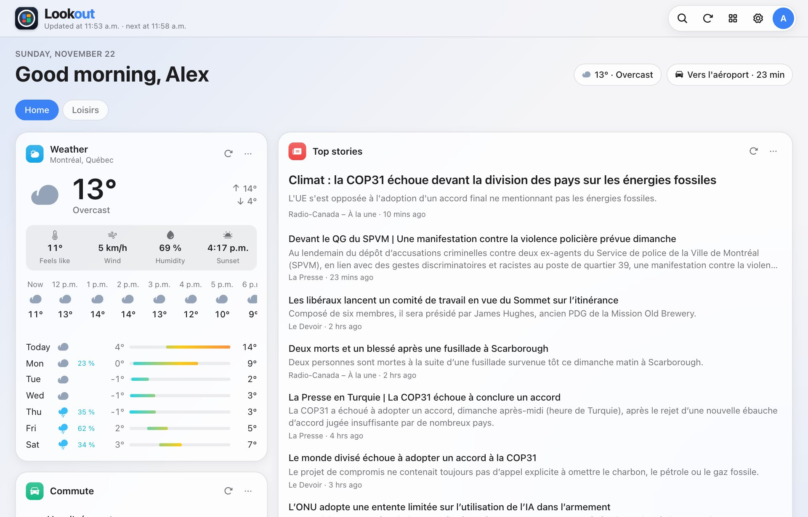

# Lookout

[](https://github.com/gharl77/lookout/actions/workflows/docker.yml)


*[Français](README.fr.md)*

Lookout is a self-hosted personal dashboard: news, weather, commute times, sports scores, videos and releases
on a single page. Everything is configured from the web UI — sections, their order, size and sources — and
every source is either an RSS feed or an API.



**Full documentation:** [user guide](docs/en/guide.md) ·
[administration guide](docs/en/administration.md) · [sources and keys](docs/en/sources.md)

- One small container, no database, no external dependency
- Multi-user: each person has a profile with their own sections, sources and preferences
- Works in any browser; on iPhone it can be added to the Home Screen like an app
- Light and dark themes, accent colour, adjustable density and column count
- Several pages (tabs), drag-and-drop layout with undo, and a badge on articles published since your last visit
- Search across every article and calendar, a “Read later” list, filters and followed keywords
- Calendar (iCal), Home Assistant (states and switches), stocks and currencies
- Notifications on iPhone, iPad, Mac and PC: weather alerts, your teams' games, new articles, morning summary, quiet hours
- Display mode for a wall screen or a TV
- A new profile is welcomed by a few questions that set up its dashboard
- Bilingual interface (English / French)
- Polite to its sources: each one is queried at most once per interval, however often you reload (30 minutes by default, 5 for scores and commute, adjustable per section)

## Sections

| Section | Source | Key required |
|---|---|---|
| RSS feeds | Any RSS or Atom feed, with keyword filters and four layouts; a catalogue of 23 categories and over 150 feeds | No |
| YouTube | Latest videos from your channels, played inside Lookout; list maintained by hand, imported from Google Takeout or synced with a Google account | No (Google client ID for syncing) |
| Weather | [Open-Meteo](https://open-meteo.com), with Environment Canada alerts | No |
| Commute | OSRM, TomTom (live traffic) or a Home Assistant sensor | TomTom only |
| Sports scores | ESPN, HockeyTech (QMJHL, PWHL, OHL, WHL, AHL), API-Sports — pick teams per league, standings, live games refreshed every minute | API-Sports only |
| JSON API | Any API returning a list, mapped by field path | Depends on the API |
| Releases | New series seasons (TVmaze) and movies in theatres or upcoming (TMDB) | TMDB only |
| Daily summary | The essentials of your feeds in a few points, by Claude (Anthropic API) | Yes, billed per use |

## Quick start

### Docker Compose (recommended)

```yaml
services:
  lookout:
    image: ghcr.io/gharl77/lookout:latest
    container_name: lookout
    restart: unless-stopped
    ports:
      - "8765:8080"
    environment:
      TZ: America/Toronto
      # LOOKOUT_PASSWORD: change-me   # optional: require a password (user "lookout")
    volumes:
      - ./data:/data
```

```bash
mkdir -p data && sudo chown 1000:1000 data
docker compose up -d
```

### Docker CLI

```bash
docker run -d \
  --name lookout \
  --restart unless-stopped \
  -p 8765:8080 \
  -e TZ=America/Toronto \
  -v /path/to/lookout/data:/data \
  ghcr.io/gharl77/lookout:latest
```

Then open `http://<server-ip>:8765`, create the administrator account, and either answer the few welcome
questions or click the gear icon to set up your sections.

## Parameters

### Ports

| Container | Description |
|---|---|
| `8080` | Web interface and API |

### Volumes

| Container path | Description |
|---|---|
| `/data` | Accounts, sessions, shared keys and one folder per profile (settings, read and saved articles, notification subscriptions). Details in the [administration guide](docs/en/administration.md#what-the-data-folder-holds) |

### Environment variables

| Variable | Default | Description |
|---|---|---|
| `TZ` | `Etc/UTC` | Time zone, used to decide what "today" means for scores (e.g. `America/Toronto`) |
| `LOOKOUT_PASSWORD` | *(none)* | Optional extra gate in front of everything (HTTP Basic authentication), on top of accounts |
| `LOOKOUT_USER` | `lookout` | User name that goes with `LOOKOUT_PASSWORD` |
| `LOOKOUT_CONTACT` | project URL | Contact (`mailto:` or `https:` address) announced to push services when sending notifications |
| `PORT` | `8080` | Port the server listens on inside the container |

## Accounts and profiles

Lookout is multi-user. The first time it is opened, it asks you to create the **administrator** account (name
and password). From then on, only administrators can create accounts.

- **Profiles**: the administrator creates one per person (Settings → Profiles), either from the default
  settings or as a copy of another profile, and can reset passwords, replace a profile's settings with a copy
  of another's, or delete it. Everyone edits their own sections, sources and preferences.
- **Staying signed in**: once signed in on a device you stay signed in — across restarts and updates — until
  you sign out or your password changes. Sign-in forms are standard, so browsers and password managers can
  save the password.
- **Passwords** are stored hashed (scrypt), never in plain text. Sessions use an `HttpOnly` cookie. A password set
  by an administrator is temporary: the person chooses their own at their next sign-in.
- **Administrators** can also see who is online, open another profile's dashboard read-only, send a copy of one
  of their sections to other profiles (card ⋯ menu), and provide **shared API keys** (TomTom, API-Sports, TMDB, Anthropic) used by
  profiles that have none of their own. The Anthropic key, the only one billed per use, is offered only to the
  profiles they choose, with a model ceiling and per-profile spending. A pane lists the failing sources of every profile.
- **Full backup** (Settings → Backup): one file with every account, each profile's settings and the API keys, which
  can be restored on the same server or on a fresh installation. Keep it somewhere safe: it contains the keys.
  An automatic backup is also written every night to `data/backups/` (fourteen days kept).
- **Create the administrator right after installing.** Until it exists, whoever opens the page first can create it.

## User and permissions

The container runs as UID/GID `1000:1000` and must be able to write to `/data`.

- **Bind mount** (as above): create the host folder first and make it writable by that user — `sudo chown 1000:1000 /path/to/lookout/data`. If the folder does not exist, Docker creates it as `root` and the container stops with a "cannot write to /data" message.
- **Another user**: add `user: "UID:GID"` to the compose file (or `--user UID:GID`) and give that user the folder.
- **Named volume**: works without any change.

## Image tags

| Tag | Description |
|---|---|
| `latest` | Latest build of the `main` branch |
| `2026.11.6` | A specific release |
| `test` | Development branch, to try things before a release |

Images are built for `linux/amd64` and `linux/arm64`.

Releases are numbered `year.month.number`: `2026.11.1` is the first release of November 2026. See the
[release notes](CHANGELOG.md).

## Updating

```bash
docker compose pull && docker compose up -d
```

In Portainer: open the stack and choose **Re-pull image and redeploy**.

## Backup

Everything lives in the `/data` volume: copy that folder to back up everything. An administrator can also
download the whole installation as a single file (**Settings → Backup**), and each person can export their own
configuration, without keys (**Settings → My data → Export**). See the
[administration guide](docs/en/administration.md#backup-and-restore).

## Security

Lookout is meant for a home network. Every profile is protected by its own password, but use HTTPS (through a
reverse proxy) if the network is not fully trusted: without it, passwords travel in clear text. HTTPS is also
required for notifications and Google sign-in.

API keys and tokens you enter are write-only: the server never sends them back to the browser (the interface
shows a mask instead) and they are left out of exported files. They are stored in plain text in
`config.json`, so protect the `/data` folder like any file holding secrets.

- Do not expose it directly to the Internet; use a VPN or a reverse proxy with HTTPS.
- Reverse proxies that cache static files (such as the "Cache Assets" option of Nginx Proxy Manager) are safe to use: interface files are served from an address that changes with every version.

## Hardened example

The container needs no extra privileges and can run with a read-only root filesystem:

```yaml
services:
  lookout:
    image: ghcr.io/gharl77/lookout:latest
    container_name: lookout
    restart: unless-stopped
    user: "1000:1000"
    ports:
      - "8765:8080"
    environment:
      TZ: America/Toronto
    volumes:
      - ./data:/data
    read_only: true
    security_opt:
      - no-new-privileges:true
    cap_drop:
      - ALL
```

## Building from source

Node.js 22 or later, no dependencies to install.

```bash
git clone https://github.com/gharl77/lookout.git
cd lookout
PORT=8080 node server.js        # run locally, data in ./data
docker build -t lookout .       # or build the image
```

Interface strings are written in French in the code; `public/i18n.js` holds their English translation.

Every build is tested before the image is published: a fresh install with default settings, a hardened
read-only install, and an unwritable data folder. Run the same checks against any instance with
`node scripts/smoke-test.mjs http://localhost:8080`.

## License

[MIT](LICENSE). The icons in `public/icons.js` come from [Phosphor Icons](https://phosphoricons.com), also MIT.

## Disclaimer

Personal project. ESPN, HockeyTech and YouTube's public feeds are undocumented interfaces that may change
without notice. The daily summary sends your feeds' headlines to Anthropic. Respect the terms of use of each service you connect.
