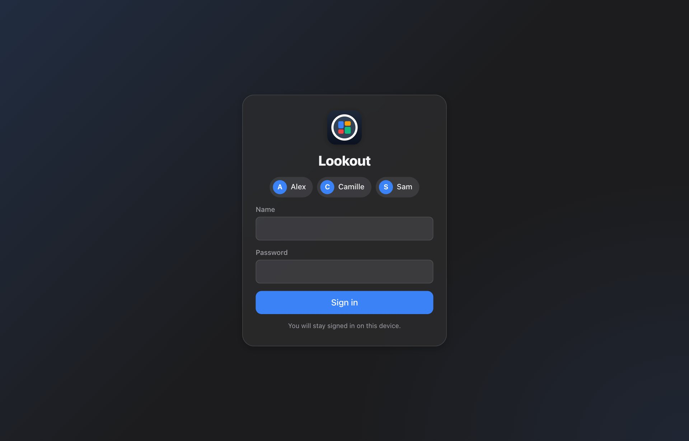
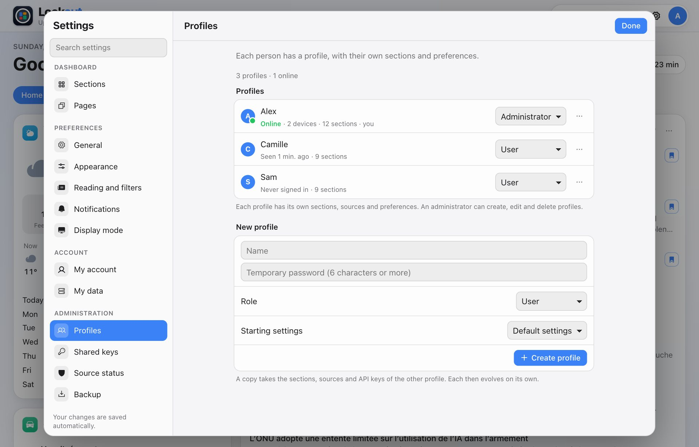
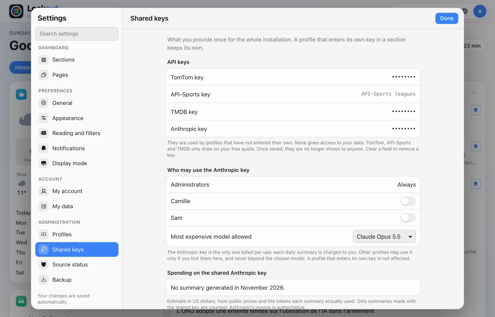
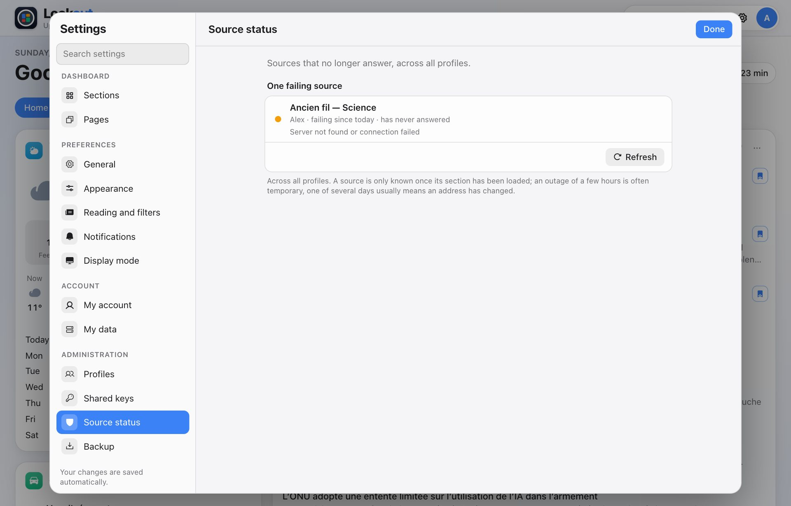
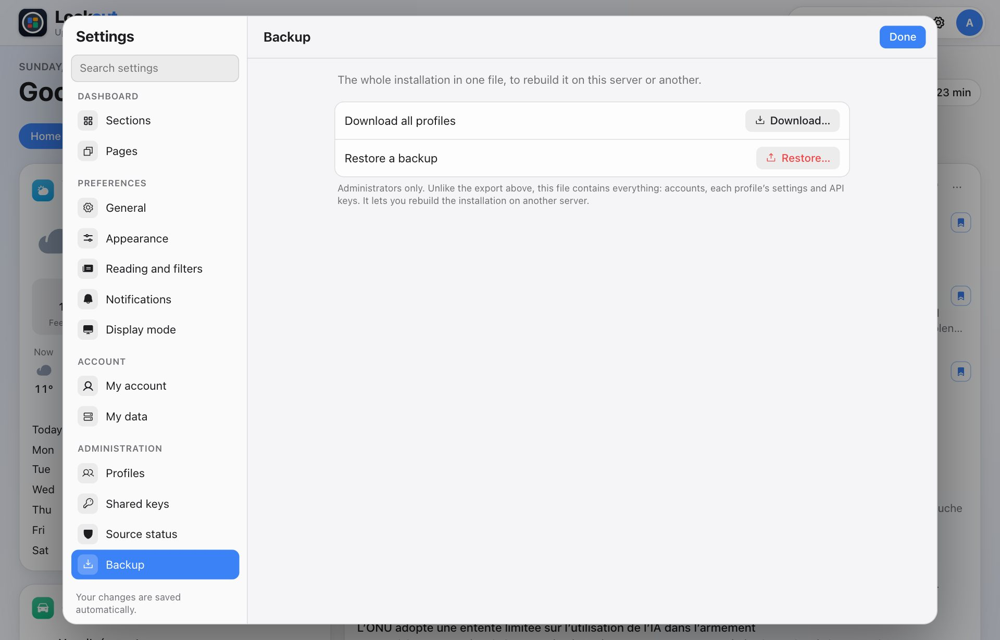

# Administration guide

*[Français](../fr/administration.md) · [Back to contents](../README.md)*

For the person who installs Lookout and manages profiles. The quick start is in the
[README](../../README.md); this guide covers the rest.

## Contents

- [Installation and first run](#installation-and-first-run)
- [HTTPS and reverse proxy](#https-and-reverse-proxy)
- [Profiles](#profiles)
- [Shared keys](#shared-keys)
- [Google sign-in for YouTube](#google-sign-in-for-youtube)
- [Source status](#source-status)
- [Email delivery](#email-delivery)
- [Backup and restore](#backup-and-restore)
- [Updating](#updating)
- [What the data folder holds](#what-the-data-folder-holds)
- [Security](#security)
- [Troubleshooting](#troubleshooting)

## Installation and first run



1. Start the container as shown in the [README](../../README.md#quick-start).
2. Open the page **right away** and create the administrator account. Until it exists, whoever opens the page
   first can create it.
3. Answer the welcome questions, or skip them.

On a fresh installation, the creation screen also offers **Restore a backup…**, to bring an existing
installation onto a new server.

**Updating from 2026.11.1** (before accounts): the first account created inherits the existing settings, keys
included. The old files are kept in `data/avant-les-comptes/`.

## HTTPS and reverse proxy

Lookout speaks HTTP on port 8080 of the container. Put it behind a reverse proxy that provides HTTPS (Nginx
Proxy Manager, Caddy, Traefik). HTTPS is needed for:

- passwords not to travel in clear text;
- **notifications**;
- **Google sign-in**.

The proxy must forward the `X-Forwarded-Proto` and `X-Forwarded-Host` headers, which these tools do by default.
Proxies that cache static files are not a problem: the address of the interface files changes with every version.

## Profiles

*Settings → Profiles.*



- **Create a profile**: name, temporary password, role, and starting settings (the defaults, or a copy of
  another profile, keys included). The person chooses their own password at first sign-in.
- **Roles**: *User* or *Administrator*. At least one administrator must always remain.
- **A profile's `⋯` menu**:

| Entry | Effect |
|---|---|
| View their dashboard | Opens the profile's dashboard **read-only** |
| Signed-in devices… | Lists devices, signs all of them out |
| Change password… | The new password is temporary; the profile's devices are signed out |
| Replace their settings with those of… | Full copy of another profile |
| Delete… | The profile folder is set aside (`profiles/supprime-<id>`), not destroyed |

- **Presence**: a green dot marks a profile that is online, with the number of devices and the last visit.
- **Read-only**: a banner says so at all times. The server refuses any write on behalf of the other profile,
  and its keys stay masked.
- **Send a section**: from the `⋯` menu of one of your cards, *Send to a profile…* drops an independent copy
  into one or more profiles. It appears the next time they load the page.

## Shared keys

*Settings → Shared keys.* What you provide once for the whole installation. A profile that enters its own key
in a section keeps its own.



| Key | Used for | Who may use it |
|---|---|---|
| TomTom | Commutes with traffic | Every profile |
| API-Sports | API-Sports leagues | Every profile |
| TMDB | Movies in the Releases section | Every profile |
| Anthropic | Daily summary | Administrators, and the profiles you tick |

Saved keys are no longer shown to anyone, not even an administrator. Clear a field to remove a key.

**The Anthropic key is the only one billed per use.** That is why:

- other profiles may use it only if you tick them, one by one;
- you set the **most expensive model allowed**: a profile that asks for more gets that model;
- the **Spending on the shared Anthropic key** block shows, per profile, the number of summaries and the
  estimated cost for the current month, and the previous month's total.

The cost is an estimate, in US dollars, from public prices and the tokens actually used. Anthropic's invoice
is authoritative.

## Google sign-in for YouTube

Optional. It lets each profile keep its YouTube section in step with its subscriptions. Without it, the
channel list is maintained by hand or by importing a Google Takeout file.

The client ID and secret **identify this installation** to Google. They give access to nobody's account: each
profile then links its own account and only sees its own subscriptions.

1. On `console.cloud.google.com`, create a project.
2. Under *APIs & Services → Library*, enable **YouTube Data API v3**.
3. Under *OAuth consent screen*, choose *External*, name the app, and add the `youtube.readonly` scope.
4. Switch the app to **In production**. In *Testing* mode, Google signs each account out after 7 days. Without
   verification by Google, a warning screen appears at sign-in: that is normal for personal use.
5. Under *Credentials*, create an **OAuth client ID** of type *Web application*.
6. Under *Authorized redirect URIs*, add the address Lookout shows you (the pane's `i` button):
   `https://your-address/api/google/callback`.
7. Copy the ID and secret into *Settings → Shared keys → Google sign-in*.

Lookout keeps only each profile's long-lived token, in a file readable by the server alone. It is not part of
the full backup: after a restore, everyone links their account again.

## Source status

*Settings → Source status.* The list of feeds, leagues and routes that no longer answer, **across all
profiles**, with how long they have been failing and when they last answered.



- A source is only known once its section has been loaded at least once.
- An outage of a few hours is often temporary.
- An outage of several days (red dot from three days on) usually means an address has changed.

## Email delivery

The morning edition can be sent by email. *Settings → Shared keys → Email delivery*:

| Field | Value |
|---|---|
| Server | The SMTP server of your email provider or of a delivery service |
| Port and encryption | 587 with STARTTLS (the most common), or 465 with TLS |
| User name and password | Those of the sending account. With Gmail, iCloud or Outlook, create an *app password* just for Lookout |
| From address | The address shown as the sender; providers often require it to be the account's own |

Save, then *Send a test email*. The password stays on the server and is no longer shown; it is part of the full
backup. Without encryption, Lookout refuses to transmit a password. Each profile then chooses, in its *Daily
summary* section, the address that receives its edition.

## Backup and restore

Four ways, from simplest to most complete.

| Means | Content | Keys included |
|---|---|---|
| *My data → Export* | One profile's configuration | No |
| *Backup → Download* | Every account, profile, “read later” list and the shared keys | Yes |
| Automatic backups (`data/backups/`) | The same content, every night, fourteen days kept | Yes |
| Copy of the `/data` folder | Everything, including notification subscriptions and Google tokens | Yes |



**Full backup** (*Settings → Backup*)
- Your password is asked again to download as well as to restore.
- The file contains API keys in clear text and password hashes: keep it somewhere safe.
- **Restore** replaces the whole installation. Everyone must sign in again with the password they had when the
  backup was made.
- The data in place is not deleted: it is moved to `data/avant-restauration-<date>/`.
- The file is checked in full before anything is written; an invalid file changes nothing.

**Automatic backups**
- Every night, around 3 a.m. (server time), Lookout writes a full backup to `data/backups/`
  (`lookout-YYYY-MM-DD.json`) and keeps only the fourteen most recent. If the server was stopped at that time,
  it is made at the next start.
- *Settings → Backup* lists them: each can be downloaded or restored, with your password. *Back up now* makes
  one on the spot, for example before an update.
- These files contain the API keys: they are readable only by the container's user. They live on the same disk
  as everything else; to guard against a server failure, copy `data/backups/` elsewhere from time to time.

## Updating

```bash
docker compose pull && docker compose up -d
```

Sessions survive an update: nobody has to sign in again. A page left open detects the new version and reloads
by itself, or offers to if you are in the middle of something.

| Image tag | Content |
|---|---|
| `latest` | Latest official release |
| `2026.11.8` | A specific release |
| `test` | Development branch, to try things before a release |

## What the data folder holds

| File or folder | Content |
|---|---|
| `users.json` | Accounts: name, role, password hash (scrypt) |
| `sessions.json` | Open sessions (only the token's hash is written) |
| `shared-keys.json` | Shared keys and the access rules for the Anthropic key |
| `usage.json` | Use of the shared Anthropic key, per profile and month (13 months) |
| `health.json` | Source status |
| `push-keys.json` | The server's keys for notifications |
| `geocode.json` | Cache of route addresses |
| `profiles/<id>/config.json` | The profile's settings, keys included |
| `profiles/<id>/read.json` | Read articles |
| `profiles/<id>/saved.json` | Articles saved for later |
| `profiles/<id>/push.json` | Devices subscribed to notifications |
| `profiles/<id>/google.json` | Token of the linked Google account |
| `avant-les-comptes/` | Settings from before the multi-user version |
| `avant-restauration-<date>/` | Data in place before a restore |
| `profiles/supprime-<id>/` | A deleted profile, kept just in case |

The last three are never cleaned up automatically: delete them when you no longer need them.

## Security

- **Passwords**: hashed with scrypt, never stored in clear text. Six characters at least.
- **Sessions**: `HttpOnly`, `SameSite=Lax` cookie, valid for 400 days. They end at sign-out or when the
  password changes.
- **Sign-in attempts**: after five failures in ten minutes, the source is held off for five minutes.
- **Requests from another site**: any request that changes something must carry a header only Lookout adds.
- **Keys and tokens**: write-only. The server never sends them back to the browser; they are absent from
  profile exports. They are stored in clear text on disk: protect `/data`.
- **Notifications**: delivery addresses are limited to the services of Apple, Google, Mozilla and Microsoft.
  A subscription is tied to the device's session and disappears with it.
- **Extra gate**: `LOOKOUT_PASSWORD` adds HTTP Basic authentication in front of everything else.

Do not publish Lookout directly on the Internet without HTTPS.

## Troubleshooting

| Symptom | Likely cause | Remedy |
|---|---|---|
| The container stops: “cannot write to /data” | Folder created by Docker as `root` | `sudo chown 1000:1000 /path/data` |
| Many sources failing at once | The container's DNS | Check Docker's DNS (`/etc/docker/daemon.json`) |
| The notifications switch is greyed out | No HTTPS, or app not opened from the Home Screen (iPhone) | See the sentence under the switch |
| Test notification “sent”, nothing appears | The browser's notifications are blocked by the system | System settings → Notifications |
| Google rejects the sign-in (`redirect_uri_mismatch`) | Redirect address differs from the one declared | Copy exactly the one from the `i` button |
| The Google account unlinks every week | Google app left in *Testing* mode | Switch it to *In production* |
| “Shared Anthropic key not offered to this profile” | Profile not ticked | *Shared keys → Who may use the Anthropic key* |
| A section does not update any faster | The section's interval | Lower it in the section's settings |

The container log (`docker logs lookout`) names each failing source and each rejected notification.
