# User guide

*[Français](../fr/guide.md) · [Back to contents](../README.md)*

This guide covers everything you can do in Lookout once signed in. For installation, accounts and backups, see
the [administration guide](administration.md); for external services and their keys, see
[Sources and keys](sources.md).

## Contents

- [First sign-in](#first-sign-in)
- [The dashboard](#the-dashboard)
- [Arranging cards](#arranging-cards)
- [Section types](#section-types)
- [Reading articles](#reading-articles)
- [Search](#search)
- [Read later](#read-later)
- [Notifications](#notifications)
- [Display mode](#display-mode)
- [Settings](#settings)
- [Keyboard shortcuts](#keyboard-shortcuts)
- [On iPhone and iPad](#on-iphone-and-ipad)

## First sign-in

An administrator creates your profile and gives you a name and a **temporary** password. The first time you
sign in, Lookout asks you to choose your own password: the administrator does not know it.

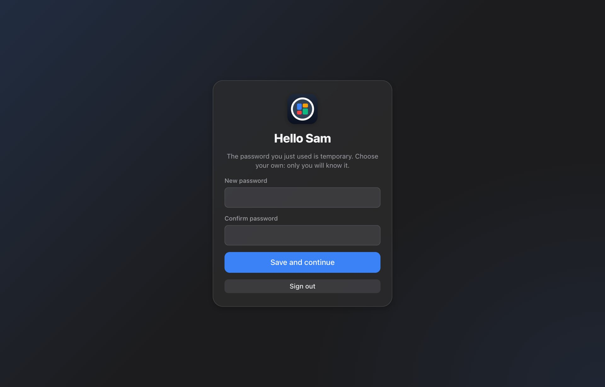

If your profile is brand new, a few questions then set up your dashboard:

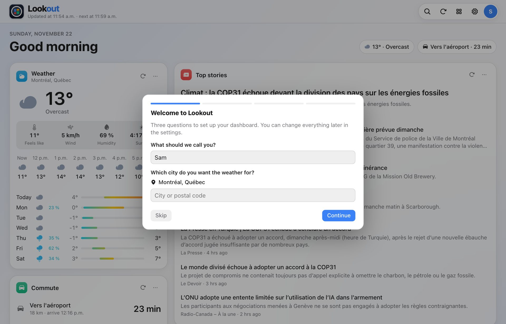

1. your first name and the city for your weather;
2. the topics you care about (each becomes a feed section);
3. the sports leagues you follow;
4. your teams in those leagues.

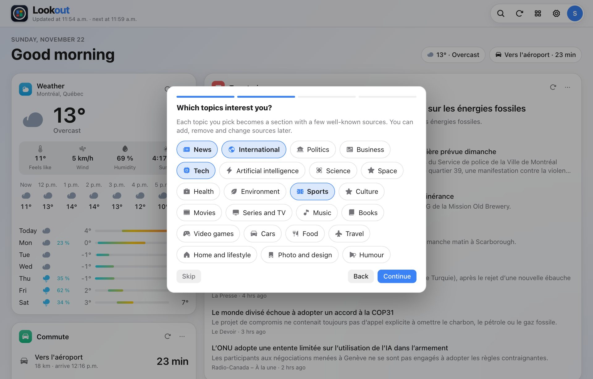

You can skip these questions at any point. Everything they set can be changed later in the settings.

Once signed in on a device you stay signed in, across server restarts and updates, until you sign out or your
password changes.

## The dashboard

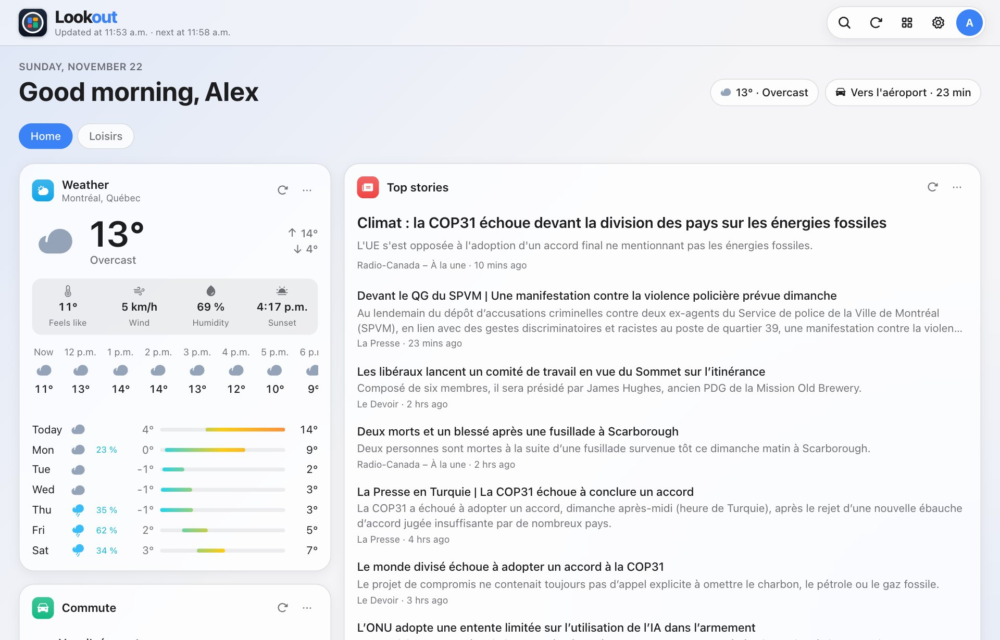

- **Top left**: the logo, then the time of the last update and of the next one.
- **Top right**, in order: *Read later* (shown once an article is saved), *Search*, *Refresh*, *Arrange*,
  *Settings*, and your account badge.
- **Greeting**: the date, a greeting with your first name, and an *at a glance* strip (weather and first commute).
- **Page tabs**, when there is more than one page.
- **Cards**: one per section.

Each card has two buttons in its header: the circular arrow updates that section only, and `⋯` opens its menu:

| Menu entry | Effect |
|---|---|
| Update now | Requests the section's data again (at most once a minute) |
| Mark all as read | For article sections |
| Width | 1, 2 or 3 columns, or full width |
| Configure… | Opens that section's settings |
| Move to page | When there are several pages |
| Send to a profile… | Administrators only: drops a copy into another profile |
| Hide | Removes the card without deleting the section |

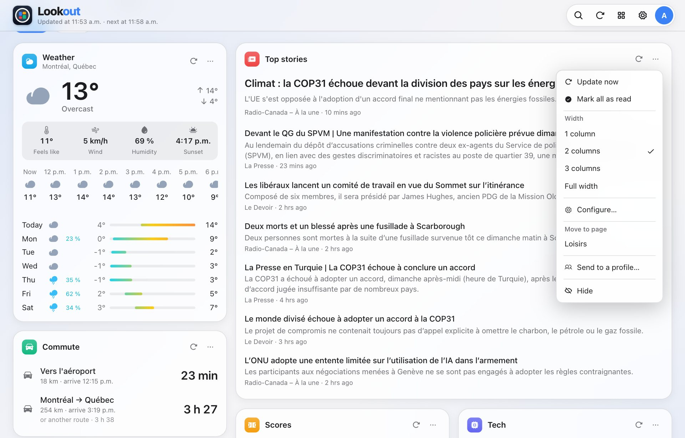

The account badge leads to *My account*, *Display mode*, *Profiles* (administrators) and sign-out.

## Arranging cards

- **With a mouse**: drag a card by its header, at any time. A line shows where it will land.
- **By touch**: tap *Arrange* first, then drag.
- Each card keeps the column you drop it in: the others do not move.
- After a move, a hide or a width change, a banner offers to **undo** for a few seconds.

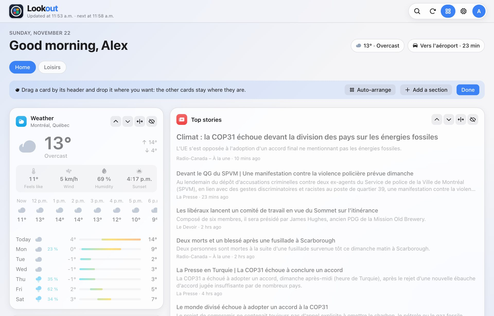

### Arrange mode

The *Arrange* button in the top bar opens everything needed to build the dashboard without going through
Settings.

**Adding a section**

- A palette shows the section types, YouTube, and under *Feeds by category* the 23 ready-made feed categories.
- **A click** adds the section to the page on screen.
- **With a mouse**, drag the tile onto the page instead: a line shows where the card will land.
- A banner then offers *Configure…* and *Undo*. The gear on the card also opens its settings.

**Creating and managing pages**

- Page tabs are always visible in this mode, even with a single page.
- *+ Page* creates an empty page, which you name right away, or a **ready-made page**: Morning, News, Sports,
  Movies and series, Tech, Culture, Videos.
- **Double-click** a tab to rename it; **drag it** to reorder the pages.
- The `⋯` button next to the active tab offers *Rename*, *Move left or right* and *Delete page*. The sections
  of a deleted page move to another page.

**Moving a card to another page**

- Drag the card by its header and **drop it on the tab** of the page you want.
- Dropped on *+ Page*, it goes to a new page.
- The card menu offers the same under *Move to page*.

*Auto-arrange* puts the cards of the page back into the least-filled columns. Every action can be undone from
the bottom banner for a few seconds.

The number of columns follows the screen width, or can be fixed in *Settings → Appearance*. On a narrow screen
everything moves to a single column.

## Section types

*Add a section* offers eight types, plus two shortcuts.

### RSS feeds

Articles from one or more RSS or Atom feeds.

- **Sources**: paste a feed address, or pick from *Suggestions* (23 categories, over 150 verified feeds). The
  order of sources is used to alternate articles.
- **Layout**: *List*, *Top stories* (first article large), *Thumbnails* or *Headlines only*.
- **Order**: newest first, or alternating between sources so a very active feed does not take over.
- **Display**: images, summary, source name, publication time.
- **Filters**: maximum age, required words, excluded words, highlighted words. Words are separated by commas
  and searched in the title and summary.
- **Notifications**: *Notify about new articles* (see [Notifications](#notifications)).

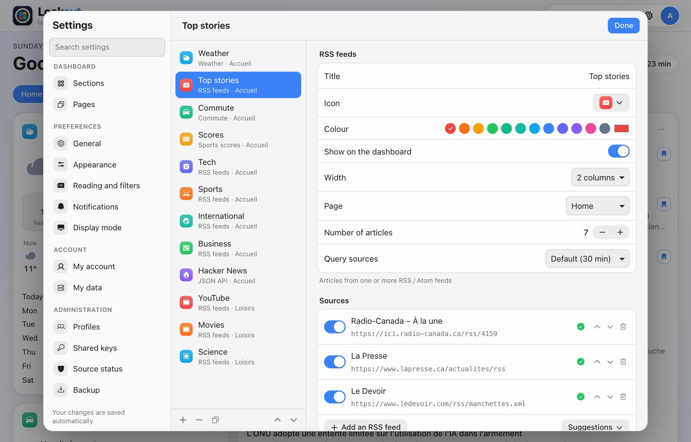

*Feeds by category…* creates a ready-made section for a topic in one step (Movies, Series and TV, Culture,
Science, Video games and so on), with three sources in the interface language.

### YouTube

The latest videos from your channels, as thumbnails. No key is needed.

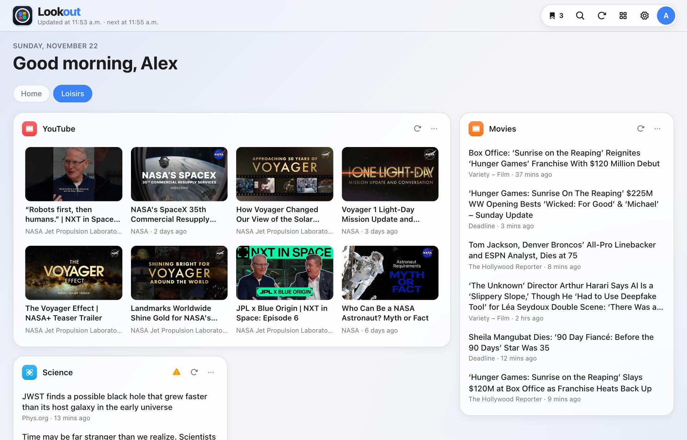

- **Add a channel**: paste its address (`youtube.com/@name`) or its `@name`.
- **Import my subscriptions…**: brings in all your channels at once from a Google Takeout file. The `i` button
  lists the steps.
- **Google account**: if the administrator has set it up, *Link my Google account* keeps the list in step with
  your subscriptions, once a day. Lookout only asks to read your subscriptions. In this mode, channels added by
  hand that are not among your subscriptions are removed at each sync.
- **Play videos inside Lookout**: a click opens the video over the dashboard. `Cmd`-click or `Ctrl`-click opens
  it on youtube.com.
- **Hide Shorts and live streams**.

### Weather

Current conditions, hourly and daily forecast for a place, from Open-Meteo. In Canada, Environment Canada
alerts are shown at the top of the card. Options: alerts, details (feels like, wind, humidity, sun), number of
hours and days.

### Commute

Travel time for one or more routes (origin, destination, travel mode).

| Service | Live traffic | Key |
|---|---|---|
| OSRM | No | None |
| TomTom | Yes | Free key |
| Home Assistant | Depends on your sensor (Waze, Google Maps) | Your Home Assistant address and token |

### Sports scores

Results, live and upcoming games, standings.

- **Leagues**: ESPN (NHL, NFL, NBA, MLB, MLS, CFL and others, or any league by its path), HockeyTech (QMJHL,
  PWHL, OHL, WHL, AHL), API-Sports (with a key).
- **Teams**: for each league, *All teams* or only the ones you follow.
- During a game of a team you follow, the section updates every minute.

### JSON API

A list taken from any API that returns JSON. You give the address, any headers and the path of the fields
(list, title, subtitle, link, date, image). See [Sources and keys](sources.md#json-api).

### Calendar

The upcoming events of one or more calendars, grouped by day.

- **Calendars**: paste the iCal address of each one (Google Calendar, iCloud, Outlook, or any `.ics` file).
  The `i` button says where to find it. No key or sign-in: Lookout reads the calendar and never changes it.
- The address gives access to the whole calendar: it is kept on the server and no longer shown once saved.
- **Display**: period (today up to 30 days), location, today's events that have already ended.
- Recurring events, exceptions and all-day events are handled.

### Home Assistant

The state of the entities you choose: temperatures, doors, lights, vacuum, power use…

- **Connection**: the Home Assistant address and a **long-lived access token** (in Home Assistant: your
  profile → *Security* → *Long-lived access tokens*). The token stays on the Lookout server and is no longer
  shown once saved.
- **Entities**: *Choose entities…* searches those of Home Assistant; Lookout only reads the ones you tick, in
  the order you give them. Each can have a display name.
- **Controls**: the card offers a switch for lights, plugs, fans and helper toggles, and a button for covers,
  scenes, scripts and automations. The option can be turned off; locks and alarms can never be operated from
  Lookout.
- The Lookout server must be able to reach Home Assistant (same network, or a public address).

### Standings and statistics

The full standings of your leagues and their leaders, in a card with tabs.

- **Leagues**: the same as for scores, from ESPN (NHL, NFL, NBA, MLB, MLS, European soccer) and HockeyTech
  (QMJHL, PWHL, OHL, WHL, AHL). With several leagues, the card offers one tab per league.
- **My teams**: pick them for each league; they are highlighted in the standings and among the leaders.
- **Standings**: by conference or by division (ESPN leagues that have them), with the record, points,
  differential, last ten games and streak. *Only the groups of my teams* shortens the card. On a narrow card,
  secondary columns are hidden.
- **Playoff race**: in the conference standings, a line marks the playoff cut, and a note gives your teams'
  gap in points (hockey and soccer). It follows the source's ranking, without every tie-breaker.
- **My teams**: a tab with, for each followed team (six at most per league), its next 5 or 10 games, its last
  five results and its best players.
- **Leaders**: the best players per category (points, goals, assists and goalies in hockey; yards and
  touchdowns in football; points, rebounds and assists in basketball; average, home runs and pitchers in
  baseball). The number per category is adjustable from 1 to 10. Not offered for soccer.
- API-Sports leagues are not offered here.

### Stocks and currencies

Quotes for stocks, indexes and currency pairs, with the change for the day.

- *Search for a stock…* finds a symbol by company name; *Suggestions* offers the main indexes and common
  currencies.
- Symbols are those of Yahoo Finance: `SHOP.TO` (Toronto Stock Exchange), `USDCAD=X` (currencies), `^GSPTSE`
  (index).
- Quotes are often delayed by about fifteen minutes and are given for information only.

### Releases

Season premieres of series (TVmaze, no key) and movies in theatres or upcoming (TMDB, free key), for a country
and a period.

### Daily summary

The essentials of your feeds in a few points, written by Claude. It needs an Anthropic key, either yours or
the one the administrator has opened to you.

- **Model**: Claude Opus 5.5 (default), Sonnet 5.5 or Haiku 5.5, from most capable to cheapest.
- **Particular emphasis**: a free-form instruction, for example “Quebec and tech first”.
- **Summarized sections**: all your feeds, or only the ones you tick.
- Only headlines from the last 24 hours are sent to Anthropic. A new summary is requested only when the
  headlines have changed, and never more than once an hour.

## Reading articles

- A click opens the article in a new tab and marks it as read.
- **Read here**: the book-shaped button on each article opens its text in a built-in reader, without leaving
  Lookout. To make it the click behaviour: *Settings → Reading and filters → Open articles in Lookout*.
  Cmd-click or Ctrl-click still opens a new tab.
- Some sites refuse the reader or keep their articles for subscribers: a button then opens the article on the
  site.
- Read articles are dimmed (adjustable). The read state is stored on the server: it follows you across devices.
- The **New** badge marks articles published since your previous visit on this device. The marker only moves
  forward if you were away for at least ten minutes.
- **New and unread first**: each card first shows the articles published since your last visit, then the
  other unread ones; an article already read only comes back if there is room left. An article you just
  opened keeps its place until the next update. Turn it off under *Settings → Reading and filters*.
- **Mark all as read**: the ✓ button in a card's header marks all its displayed articles; a banner lets you
  undo. It only appears while unread articles remain.
- **Duplicates**: when several sections on the same page receive the same story (top stories, world,
  politics…), only the first one in page order shows it; the others show their next article. Under the
  article, *also in…* names the sections that received it too. Turn it off under
  *Settings → Reading and filters*.
- **Grouped topics**: when several sources cover the same event with similar headlines, a single article is
  shown, followed by *also: La Presse, Le Devoir*; clicking a name opens its article. Matching works on
  headline words, within one language: it may miss a topic or bring together two neighbouring stories. Turn
  it off under *Settings → Reading and filters*.
- **Followed keywords** (*Settings → Reading and filters*): an article containing one is highlighted in all
  your sections, and can trigger a notification.
- Right-click an article (desktop): open, copy link, save for later, mark read or unread.

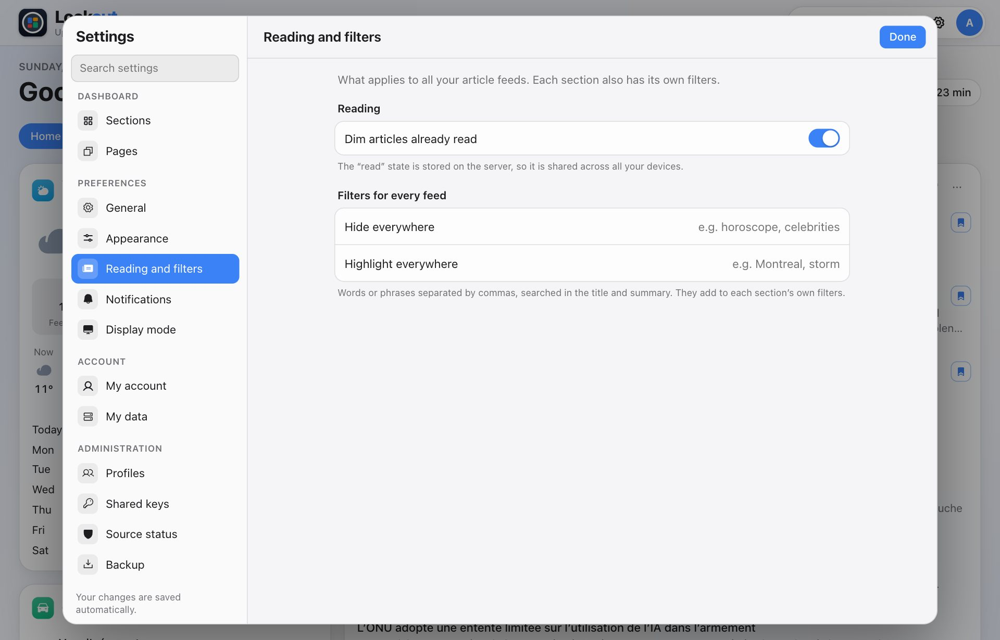

**Summarizing an article.** In the built-in reader, *Summarize* asks Claude for three to five points about the
article. The button only appears if you have an Anthropic key (in a *Daily summary* section, or shared by an
administrator). Each summary is billed per use, a few cents at most; the same article is not summarized twice.

## Search

The magnifying glass, or the `/` key, searches the articles of **all** your sections, across every page, the
events of your calendars and *Read later*. With several words, all must be present.

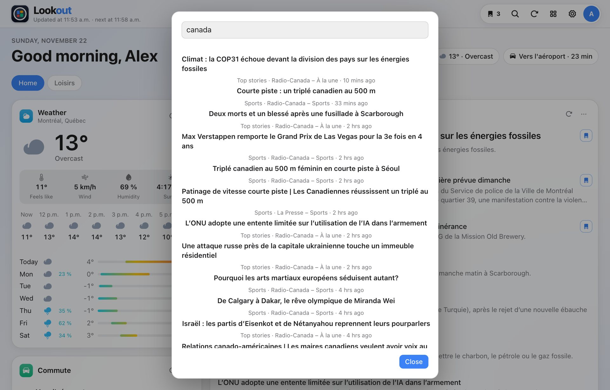

## Read later

The bookmark on an article keeps it in a personal list. It appears on hover with a mouse and is always visible
on touch screens. The list (200 articles at most) is stored on the server and shared across your devices. Open
it with the bookmark button in the top bar.

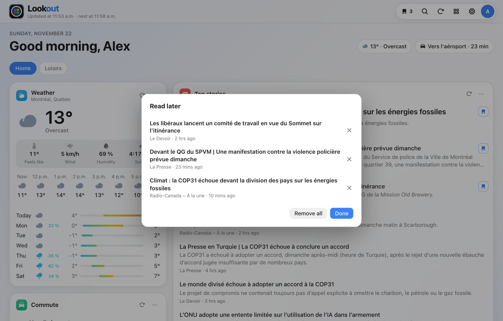

## Notifications

*Settings → Notifications.* Lookout can alert you even when the page is closed.

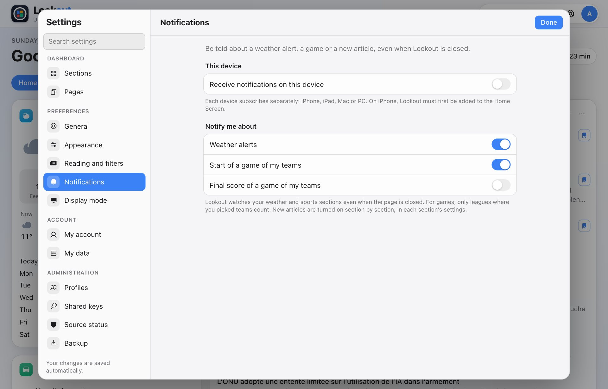

**Requirements**
- The address must be **HTTPS**.
- On **iPhone or iPad**, first add Lookout to the Home Screen (*Share → Add to Home Screen*) and open it from
  its icon.
- On **Mac or PC**, use Safari, Chrome, Edge or Firefox, and allow that browser's notifications in the system
  settings.

**What triggers a notification**
- a new **weather alert** for one of your weather sections;
- the **start of a game** of a team you follow, and its **final score** if you turn that on;
- a **new article** in a section where you turned on *Notify about new articles*. Tapping the notification
  opens the article. Beyond three new items at once, a single notification announces them;
- an article containing one of your **followed keywords**, in any of your feeds (except YouTube).

**Quiet hours.** During the chosen range (10 p.m. to 7 a.m. by default) nothing is sent, and nothing is sent
later to catch up. Weather alerts can still get through.

**Morning summary.** At the chosen time, one notification brings together the weather, today's events and the
top headlines of your first sections.

Quiet hours and the morning summary follow the server's clock.

Each device subscribes separately. The *Send a test notification* button checks the full path for this device.
How quickly an article notification arrives depends on the section's interval.

## Display mode

For a wall screen, a tablet or a TV: full screen, no buttons, with the time. Pages rotate (duration set in
*Settings → Display mode*) and the screen stays on.

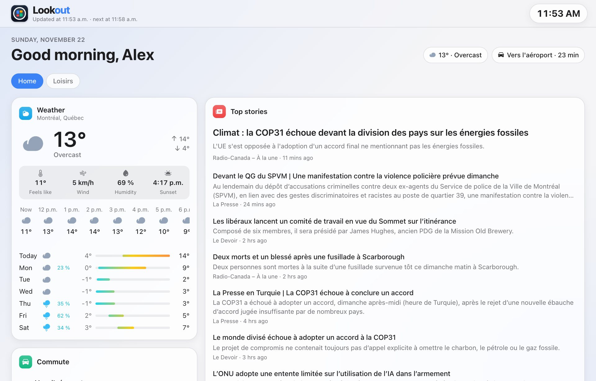

- **Enter**: account badge → *Display mode*, or the settings.
- **Leave**: `Escape`, or touch the screen then *Leave*.
- The address keeps `?affichage=1`: bookmark it to come straight back.

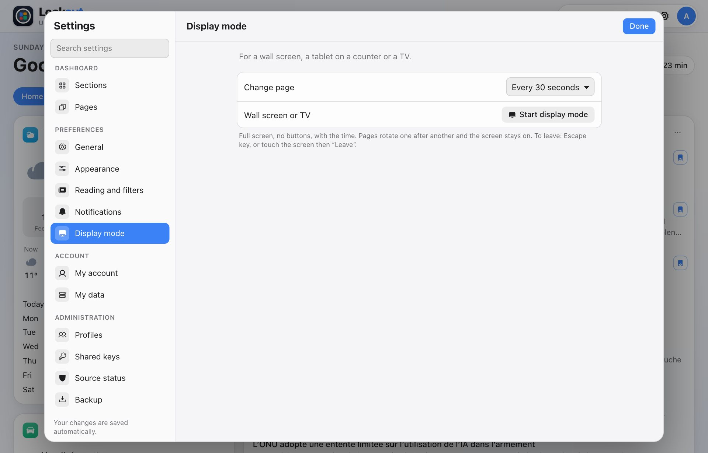

## Settings

The gear, or `Cmd`+`,`. Changes are saved automatically. A search field at the top of the navigation finds a
setting by keyword.

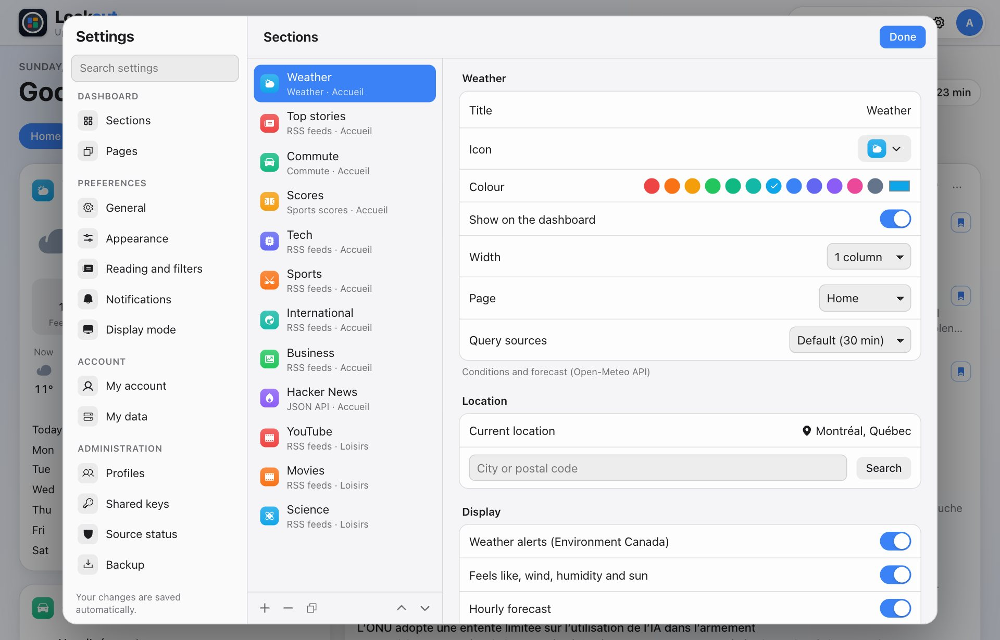

| Group | Pane | What it holds |
|---|---|---|
| Dashboard | Sections and pages | The tree of pages and their sections: add, drag from one page to another, rename or delete a page (`⋯` menu), configure, duplicate or delete each section |
| | Appearance | Theme, accent colour, backdrop, density, number of columns |
| | Display mode | Duration of each page; start the mode |
| Preferences | General | Language, units, greeting, default update interval |
| | Reading and filters | Dim read articles; duplicates; built-in reader; hidden words and followed keywords in every feed |
| | Notifications | Subscribe this device; choose what triggers a notification; quiet hours; morning summary |
| Account | My account | Password, sign-out |
| | My data | Export, import or reset your own configuration |
| — | About | Version, location of your settings, links |

Administrators also see the *Administration* group: see the [administration guide](administration.md).

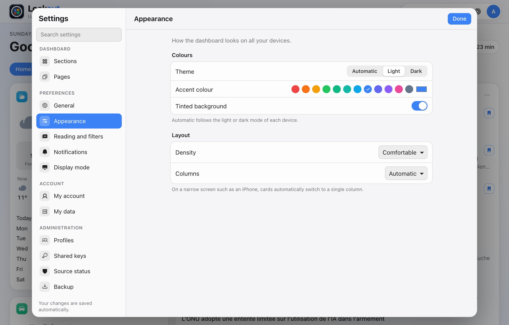

**Updating sources.** Each source is queried at most once per interval, even if you reload the page more
often: this keeps sites from blocking you. The default interval is 30 minutes; scores and commutes use
5 minutes, as does Home Assistant; the calendar and stocks use 15 minutes, YouTube and standings one hour, releases and the
summary 2 hours. Each section can have its own. A failing source is retried twice, two minutes apart, then at
the normal pace. When data is due for renewal, the card first shows what it has, then updates a few seconds later.

**Export and import.** The exported file contains your sections, sources and preferences, but neither your
keys nor your tokens.

## Keyboard shortcuts

| Key | Action |
|---|---|
| `/` or `Cmd`/`Ctrl`+`K` | Search articles and calendars |
| `R` | Refresh all sections |
| `E` | Arrange the dashboard |
| `L` | Open *Read later* |
| `1` to `9` | Go to the page at that position |
| `←` `→` | Previous or next page |
| `?` | Show the list of shortcuts |
| `Cmd`/`Ctrl`+`,` | Open settings |
| `Escape` | Close a window, cancel a drag, leave display mode |

## On iPhone and iPad

In Safari: *Share → Add to Home Screen*. Lookout then opens like an app, full screen, and can receive
notifications. Cards move to a single column and settings show one pane at a time, with a *Back* button.

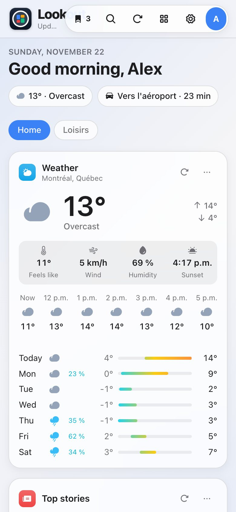 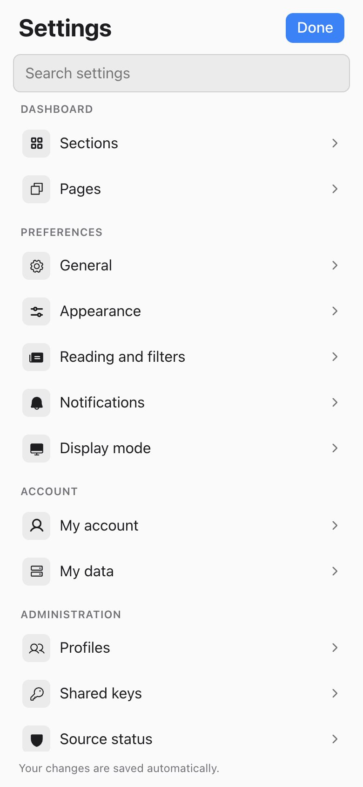 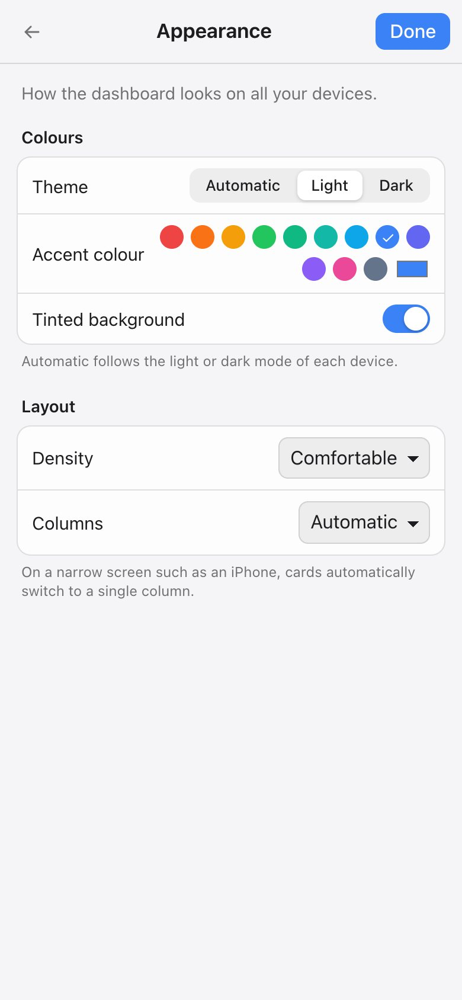

