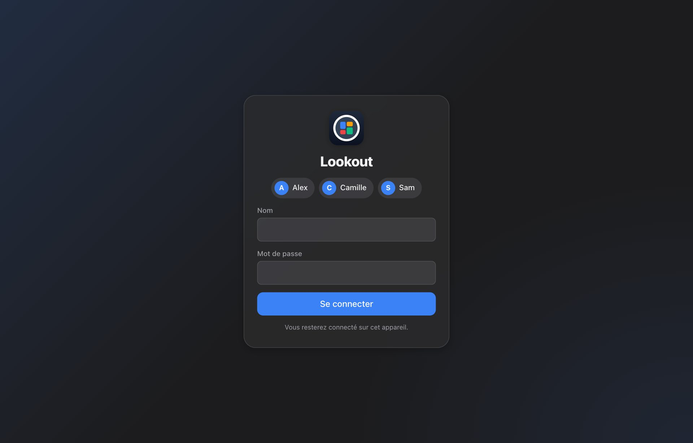
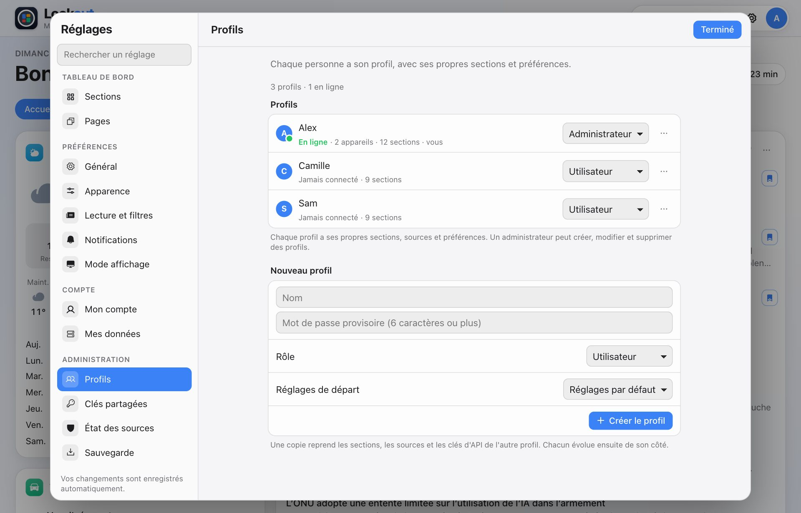
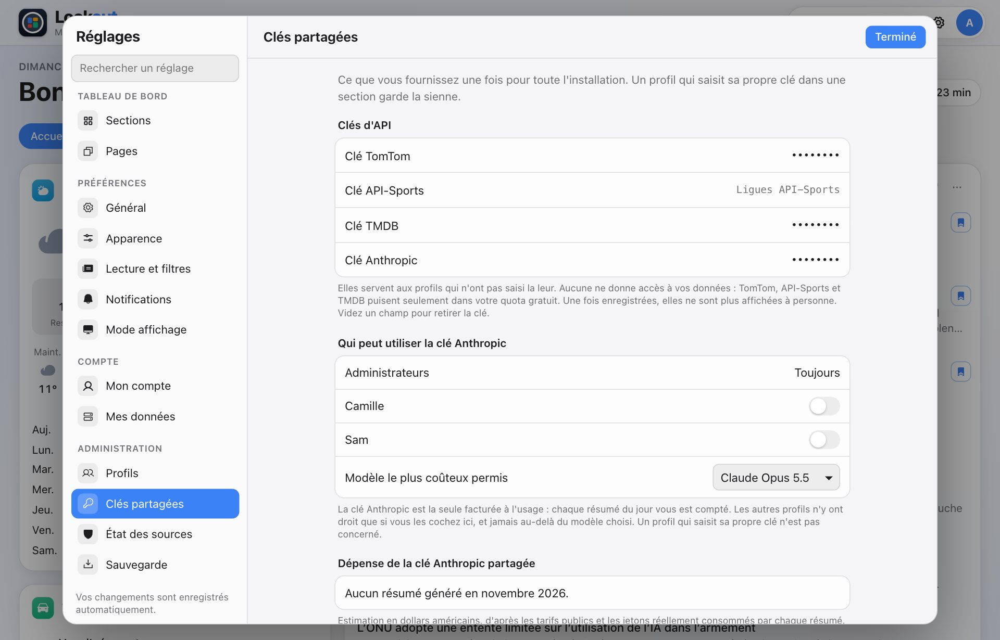
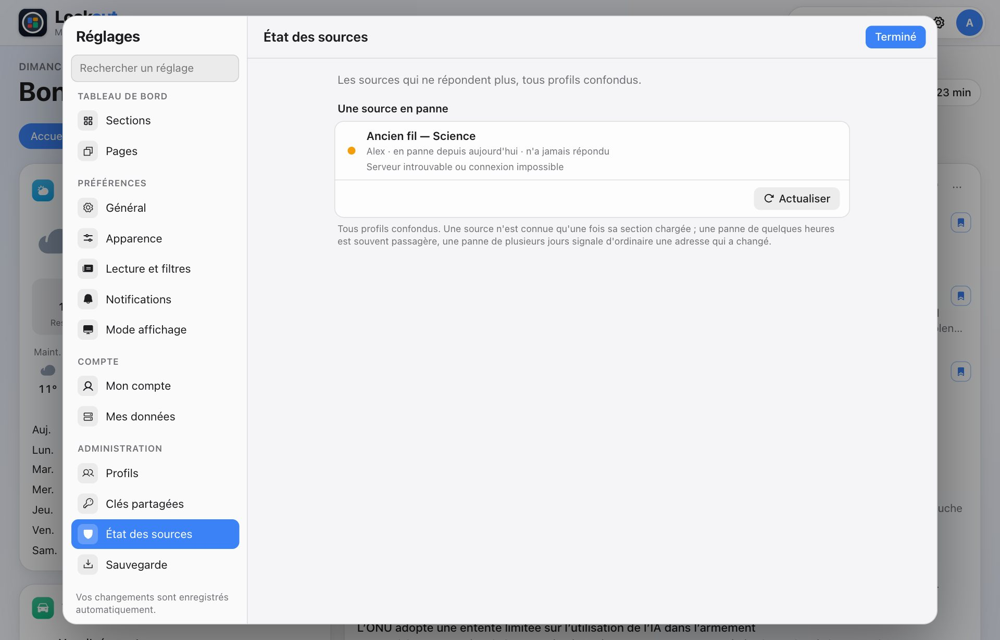
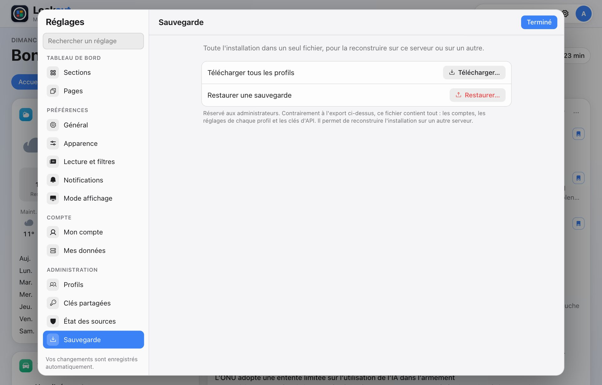

# Guide d'administration

*[English](../en/administration.md) · [Retour au sommaire](../README.md)*

Pour la personne qui installe Lookout et qui gère les profils. L'installation rapide est dans le
[README](../../README.fr.md) ; ce guide couvre le reste.

## Sommaire

- [Installation et première ouverture](#installation-et-première-ouverture)
- [HTTPS et proxy inverse](#https-et-proxy-inverse)
- [Profils](#profils)
- [Clés partagées](#clés-partagées)
- [Connexion Google pour YouTube](#connexion-google-pour-youtube)
- [État des sources](#état-des-sources)
- [Envoi de courriels](#envoi-de-courriels)
- [Sauvegarde et restauration](#sauvegarde-et-restauration)
- [Mise à jour](#mise-à-jour)
- [Ce que contient le dossier de données](#ce-que-contient-le-dossier-de-données)
- [Sécurité](#sécurité)
- [Dépannage](#dépannage)

## Installation et première ouverture



1. Lancez le conteneur comme indiqué dans le [README](../../README.fr.md#démarrage-rapide).
2. Ouvrez la page **tout de suite** et créez le compte administrateur. Tant qu'il n'existe pas, la première
   personne qui ouvre la page peut le créer.
3. Répondez aux questions d'accueil, ou passez-les.

Sur une installation neuve, l'écran de création propose aussi **Restaurer une sauvegarde…**, pour reprendre
une installation existante sur un nouveau serveur.

**Mise à jour depuis 2026.11.1** (avant les comptes) : le premier compte créé hérite des réglages existants,
clés comprises. Les anciens fichiers sont conservés dans `data/avant-les-comptes/`.

## HTTPS et proxy inverse

Lookout parle HTTP sur le port 8080 du conteneur. Placez-le derrière un proxy inverse qui fournit le HTTPS
(Nginx Proxy Manager, Caddy, Traefik). Le HTTPS est nécessaire pour :

- que les mots de passe ne circulent pas en clair ;
- les **notifications** ;
- la **connexion Google**.

Le proxy doit transmettre les en-têtes `X-Forwarded-Proto` et `X-Forwarded-Host`, ce que font ces outils par
défaut. Les proxys qui mettent les fichiers statiques en cache ne posent pas de problème : l'adresse des
fichiers de l'interface change à chaque version.

## Profils

*Réglages → Profils.*



- **Créer un profil** : nom, mot de passe provisoire, rôle, et réglages de départ (ceux par défaut, ou une
  copie d'un autre profil, clés comprises). La personne choisit son propre mot de passe à sa première connexion.
- **Rôles** : *Utilisateur* ou *Administrateur*. Il doit toujours rester au moins un administrateur.
- **Menu `⋯` d'un profil** :

| Entrée | Effet |
|---|---|
| Voir son tableau de bord | Ouvre le tableau de bord du profil en **lecture seule** |
| Appareils connectés… | Liste des appareils, déconnexion de tous |
| Changer le mot de passe… | Le nouveau mot de passe est provisoire ; les appareils du profil sont déconnectés |
| Remplacer ses réglages par ceux de… | Copie complète d'un autre profil |
| Supprimer… | Le dossier du profil est mis de côté (`profiles/supprime-<id>`), pas détruit |

- **Présence** : une pastille verte signale un profil en ligne, avec le nombre d'appareils et la dernière visite.
- **Lecture seule** : un bandeau le rappelle en permanence. Le serveur refuse toute écriture au nom de l'autre
  profil, et ses clés restent masquées.
- **Envoyer une section** : depuis le menu `⋯` d'une de vos cartes, *Envoyer à un profil…* dépose une copie
  indépendante chez un ou plusieurs profils. Elle apparaît à leur prochain chargement de la page.

## Clés partagées

*Réglages → Clés partagées.* Ce que vous fournissez une fois pour toute l'installation. Un profil qui saisit sa
propre clé dans une section garde la sienne.



| Clé | Sert à | Qui peut l'utiliser |
|---|---|---|
| TomTom | Trajets avec circulation | Tous les profils |
| API-Sports | Ligues API-Sports | Tous les profils |
| TMDB | Films de la section Sorties | Tous les profils |
| Anthropic | Résumé par courriel, résumé d'article | Les administrateurs, et les profils que vous cochez |

Les clés enregistrées ne sont plus affichées à personne, pas même à un administrateur. Videz un champ pour
retirer une clé.

**La clé Anthropic est la seule facturée à l'usage.** C'est pourquoi :

- les autres profils n'y ont droit que si vous les cochez, un par un ;
- vous fixez le **modèle le plus coûteux permis** : un profil qui demande plus reçoit ce modèle ;
- le bloc **Dépense de la clé Anthropic partagée** montre, par profil, le nombre de résumés et le coût estimé
  du mois en cours, ainsi que le total du mois précédent.

Le coût est une estimation, en dollars américains, d'après les tarifs publics et les jetons réellement
consommés. La facture d'Anthropic fait foi.

## Connexion Google pour YouTube

Facultatif. Elle permet à chaque profil de tenir sa section YouTube à jour d'après ses abonnements. Sans elle,
la liste des chaînes se tient à la main ou par import d'un fichier Google Takeout.

L'identifiant et le secret client **identifient cette installation** auprès de Google. Ils ne donnent accès au
compte de personne : chaque profil relie ensuite son propre compte et ne voit que ses propres abonnements.

1. Sur `console.cloud.google.com`, créez un projet.
2. Dans *API et services → Bibliothèque*, activez **YouTube Data API v3**.
3. Dans *Écran de consentement OAuth*, choisissez *Externe*, nommez l'application, et ajoutez la portée
   `youtube.readonly`.
4. Passez l'application **En production**. En mode *Test*, Google déconnecte chaque compte au bout de 7 jours.
   Sans validation par Google, un écran d'avertissement s'affiche à la connexion : c'est normal pour un usage
   personnel.
5. Dans *Identifiants*, créez un **ID client OAuth** de type *Application Web*.
6. Sous *URI de redirection autorisés*, ajoutez l'adresse que Lookout vous indique (bouton `i` de la rubrique) :
   `https://votre-adresse/api/google/callback`.
7. Copiez l'identifiant et le secret dans *Réglages → Clés partagées → Connexion Google*.

Lookout ne garde que le jeton durable de chaque profil, dans un fichier lisible par le serveur seulement. Il
n'entre pas dans la sauvegarde complète : après une restauration, chacun relie de nouveau son compte.

## État des sources

*Réglages → État des sources.* La liste des fils, ligues et trajets qui ne répondent plus, **tous profils
confondus**, avec la durée de la panne et la dernière réponse reçue.



- Une source n'est connue qu'une fois sa section chargée au moins une fois.
- Une panne de quelques heures est souvent passagère.
- Une panne de plusieurs jours (pastille rouge à partir de trois jours) signale d'ordinaire une adresse qui a
  changé.

## Envoi de courriels

Le résumé quotidien est envoyé par courriel. *Réglages → Clés partagées → Envoi de courriels* :

| Champ | Valeur |
|---|---|
| Serveur | Le serveur SMTP de votre fournisseur de courriel ou d'un service d'envoi |
| Port et chiffrement | 587 avec STARTTLS (le plus courant), ou 465 avec TLS |
| Nom d'utilisateur et mot de passe | Ceux du compte d'envoi. Avec Gmail, iCloud ou Outlook, créez un *mot de passe d'application* réservé à Lookout |
| Adresse d'expédition | L'adresse qui figure comme expéditeur ; le fournisseur exige souvent que ce soit celle du compte |

Enregistrez, puis *Envoyer un courriel d'essai*. Le mot de passe reste sur le serveur et n'est plus affiché ; il
fait partie de la sauvegarde complète. Sans chiffrement, Lookout refuse de transmettre un mot de passe. Chaque
profil choisit ensuite, dans *Réglages → Résumé par courriel*, l'adresse qui reçoit son résumé.

## Sauvegarde et restauration

Quatre moyens, du plus simple au plus complet.

| Moyen | Contenu | Clés comprises |
|---|---|---|
| *Mes données → Exporter* | La configuration d'un seul profil | Non |
| *Sauvegarde → Télécharger* | Tous les comptes, profils, listes « à lire plus tard » et clés partagées | Oui |
| Sauvegardes automatiques (`data/backups/`) | Le même contenu, chaque nuit, quatorze jours gardés | Oui |
| Copie du dossier `/data` | Tout, y compris les abonnements aux notifications et les jetons Google | Oui |



**Sauvegarde complète** (*Réglages → Sauvegarde*)
- Votre mot de passe est redemandé pour télécharger comme pour restaurer.
- Le fichier contient les clés d'API en clair et les empreintes des mots de passe : gardez-le en lieu sûr.
- **Restaurer** remplace toute l'installation. Tout le monde doit se reconnecter avec le mot de passe qu'il
  avait au moment de la sauvegarde.
- Les données en place ne sont pas supprimées : elles sont déplacées dans `data/avant-restauration-<date>/`.
- Le fichier est vérifié en entier avant toute écriture ; un fichier invalide ne touche à rien.

**Sauvegardes automatiques**
- Chaque nuit, vers 3 h (heure du serveur), Lookout écrit une sauvegarde complète dans `data/backups/`
  (`lookout-AAAA-MM-JJ.json`) et ne garde que les quatorze plus récentes. Si le serveur était arrêté à ce
  moment, elle est faite à son prochain démarrage.
- *Réglages → Sauvegarde* les liste : chacune peut être téléchargée ou restaurée, mot de passe à l'appui.
  *Sauvegarder maintenant* en fait une sur-le-champ, par exemple avant une mise à jour.
- Ces fichiers contiennent les clés d'API : ils ne sont lisibles que par l'utilisateur du conteneur. Ils se
  trouvent sur le même disque que le reste ; pour vous protéger d'une panne du serveur, copiez `data/backups/`
  ailleurs de temps à autre.

## Mise à jour

```bash
docker compose pull && docker compose up -d
```

Les sessions survivent à une mise à jour : personne n'a à se reconnecter. Une page restée ouverte détecte la
nouvelle version et se recharge d'elle-même, ou le propose si vous êtes en train de faire quelque chose.

| Étiquette d'image | Contenu |
|---|---|
| `latest` | Dernière version officielle |
| `2026.11.10` | Une version précise |
| `test` | Branche de développement, pour essayer avant une version |

## Ce que contient le dossier de données

| Fichier ou dossier | Contenu |
|---|---|
| `users.json` | Comptes : nom, rôle, empreinte du mot de passe (scrypt) |
| `sessions.json` | Sessions ouvertes (seule l'empreinte du jeton y est écrite) |
| `shared-keys.json` | Clés partagées et règles d'accès à la clé Anthropic |
| `usage.json` | Usage de la clé Anthropic partagée, par profil et par mois (13 mois) |
| `health.json` | État des sources |
| `push-keys.json` | Clés du serveur pour les notifications |
| `geocode.json` | Cache des adresses des trajets |
| `profiles/<id>/config.json` | Réglages du profil, clés comprises |
| `profiles/<id>/read.json` | Articles lus |
| `profiles/<id>/saved.json` | Articles gardés « à lire plus tard » |
| `profiles/<id>/push.json` | Appareils abonnés aux notifications |
| `profiles/<id>/google.json` | Jeton du compte Google relié |
| `avant-les-comptes/` | Réglages d'avant la version multiutilisateur |
| `avant-restauration-<date>/` | Données en place avant une restauration |
| `profiles/supprime-<id>/` | Profil supprimé, gardé au cas où |

Les trois derniers ne sont jamais nettoyés automatiquement : supprimez-les quand vous n'en avez plus besoin.

## Sécurité

- **Mots de passe** : hachés avec scrypt, jamais enregistrés en clair. Six caractères au moins.
- **Sessions** : témoin `HttpOnly`, `SameSite=Lax`, valable 400 jours. Elles tombent à la déconnexion ou au
  changement de mot de passe.
- **Tentatives de connexion** : après cinq échecs en dix minutes, la source est mise en attente cinq minutes.
- **Requêtes venues d'un autre site** : toute requête qui modifie quelque chose doit porter un en-tête que seul
  Lookout ajoute.
- **Clés et jetons** : en écriture seule. Le serveur ne les renvoie jamais au navigateur ; ils sont absents des
  exports de profil. Ils sont enregistrés en clair sur le disque : protégez `/data`.
- **Notifications** : les adresses d'envoi sont limitées aux services d'Apple, Google, Mozilla et Microsoft.
  Un abonnement est lié à la session de l'appareil et disparaît avec elle.
- **Barrière supplémentaire** : `LOOKOUT_PASSWORD` ajoute une authentification HTTP Basic devant tout le reste.

Ne publiez pas Lookout directement sur Internet sans HTTPS.

## Dépannage

| Symptôme | Cause probable | Remède |
|---|---|---|
| Le conteneur s'arrête : « ne peut pas écrire dans /data » | Dossier créé par Docker au nom de `root` | `sudo chown 1000:1000 /chemin/data` |
| Beaucoup de sources en erreur en même temps | DNS du conteneur | Vérifier le DNS de Docker (`/etc/docker/daemon.json`) |
| L'interrupteur des notifications est grisé | Pas de HTTPS, ou app non ouverte depuis l'écran d'accueil (iPhone) | Voir la phrase sous l'interrupteur |
| Notification d'essai « envoyée », rien n'apparaît | Notifications du navigateur bloquées par le système | Réglages du système → Notifications |
| Google refuse la connexion (`redirect_uri_mismatch`) | Adresse de redirection différente de celle déclarée | Copier exactement celle du bouton `i` |
| Le compte Google se délie chaque semaine | Application Google restée en mode *Test* | La passer *En production* |
| « Clé Anthropic partagée non offerte à ce profil » | Profil non coché | *Clés partagées → Qui peut utiliser la clé Anthropic* |
| Une section ne se met pas à jour plus vite | Intervalle de la section | Le réduire dans les réglages de la section |

Le journal du conteneur (`docker logs lookout`) nomme chaque source en échec et chaque notification refusée.
