# Guide d'utilisation

*[English](../en/guide.md) · [Retour au sommaire](../README.md)*

Ce guide décrit tout ce qu'on peut faire dans Lookout une fois connecté. Pour l'installation, les comptes et
la sauvegarde, voir le [guide d'administration](administration.md) ; pour les services externes et leurs clés,
voir [Sources et clés](sources.md).

## Sommaire

- [Première connexion](#première-connexion)
- [Le tableau de bord](#le-tableau-de-bord)
- [Organiser les cartes](#organiser-les-cartes)
- [Les types de section](#les-types-de-section)
- [Lire les articles](#lire-les-articles)
- [Recherche](#recherche)
- [À lire plus tard](#à-lire-plus-tard)
- [Notifications](#notifications)
- [Mode affichage](#mode-affichage)
- [Les réglages](#les-réglages)
- [Raccourcis clavier](#raccourcis-clavier)
- [Sur iPhone et iPad](#sur-iphone-et-ipad)

## Première connexion

Un administrateur vous crée un profil et vous donne un nom et un mot de passe **provisoire**. À votre première
connexion, Lookout vous demande de choisir votre propre mot de passe : l'administrateur ne le connaît pas.

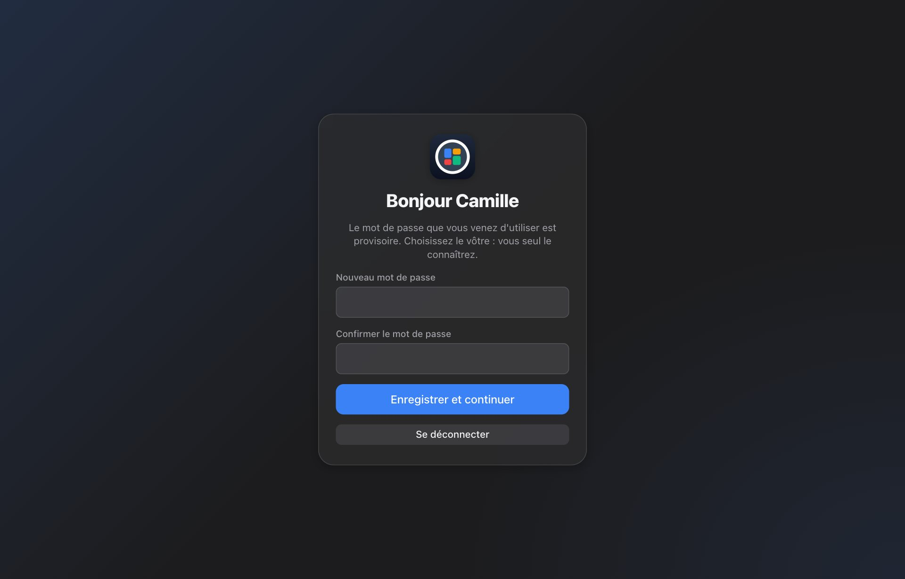

Si votre profil est tout neuf, quelques questions préparent ensuite votre tableau de bord :

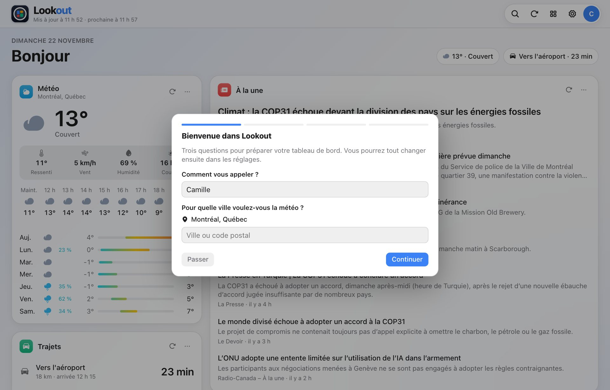

1. votre prénom et la ville de votre météo ;
2. les sujets qui vous intéressent (chacun devient une section de fils) ;
3. les ligues sportives que vous suivez ;
4. vos équipes dans ces ligues.

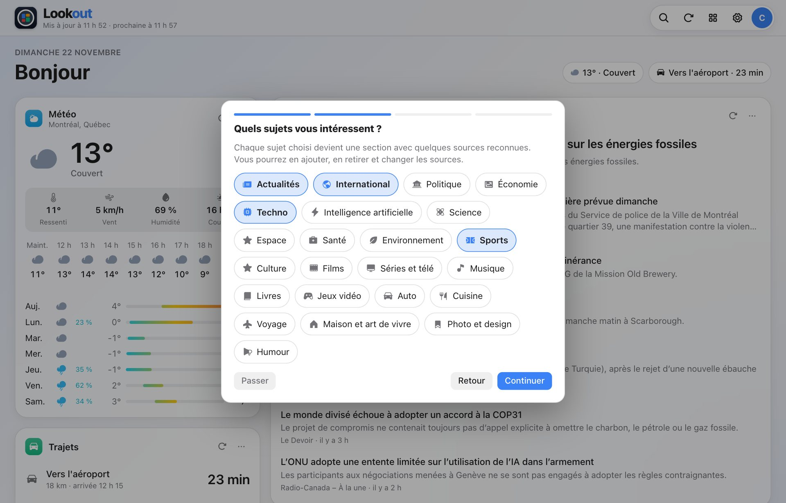

Vous pouvez passer ces questions à tout moment. Tout ce qu'elles règlent reste modifiable dans les réglages.

Une fois connecté sur un appareil, vous le restez, même après un redémarrage ou une mise à jour du serveur,
jusqu'à ce que vous vous déconnectiez ou que votre mot de passe change.

## Le tableau de bord

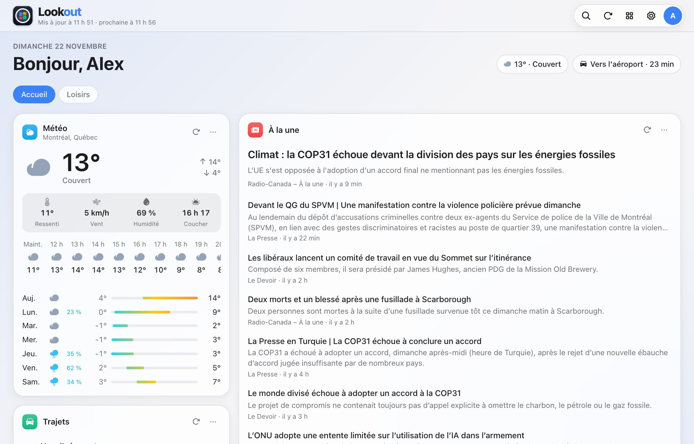

- **En haut à gauche** : le logo, puis l'heure de la dernière mise à jour et celle de la prochaine.
- **En haut à droite**, dans l'ordre : *À lire plus tard* (visible dès qu'un article est gardé), *Rechercher*,
  *Actualiser*, *Organiser*, *Réglages*, et la pastille de votre compte.
- **Message d'accueil** : la date, « Bonjour » avec votre prénom, et un *coup d'œil* (météo et premier trajet).
- **Onglets de pages**, s'il y a plus d'une page.
- **Les cartes** : une par section.

Chaque carte a deux boutons dans son en-tête : la flèche circulaire met à jour cette seule section, et `⋯`
ouvre son menu :

| Entrée du menu | Effet |
|---|---|
| Mettre à jour maintenant | Redemande les données de la section (au plus une fois par minute) |
| Tout marquer comme lu | Pour les sections d'articles |
| Largeur | 1, 2 ou 3 colonnes, ou pleine largeur |
| Configurer… | Ouvre les réglages de cette section |
| Déplacer vers la page | S'il y a plusieurs pages |
| Envoyer à un profil… | Administrateurs seulement : dépose une copie chez un autre profil |
| Masquer | Retire la carte sans supprimer la section |

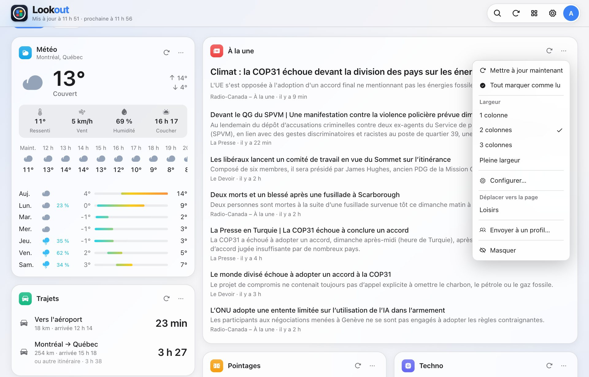

La pastille du compte donne accès à *Mon compte*, au *Mode affichage*, aux *Profils* (administrateurs) et à la
déconnexion.

## Organiser les cartes

- **À la souris** : glissez une carte par son en-tête, à tout moment. Une ligne indique où elle se posera.
- **Au doigt** : touchez d'abord *Organiser*, puis glissez.
- Chaque carte garde la colonne où vous la déposez : les autres ne bougent pas.
- Après un déplacement, un masquage ou un changement de largeur, un bandeau propose d'**annuler** pendant
  quelques secondes.

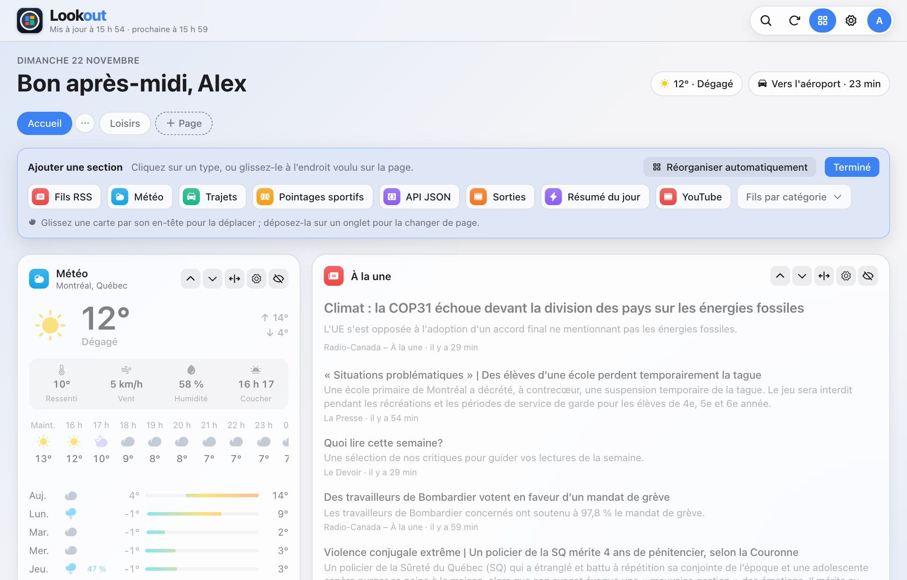

### Le mode Organiser

Le bouton *Organiser* de la barre du haut ouvre tout ce qu'il faut pour composer le tableau de bord sans
passer par les réglages.

**Ajouter une section**

- Une palette montre les types de section, YouTube, et sous *Fils par catégorie* les 23 catégories de fils
  prêtes à l'emploi.
- **Un clic** ajoute la section à la page affichée.
- **À la souris**, glissez plutôt la tuile sur la page : un trait montre où la carte se posera.
- Un bandeau propose ensuite *Configurer…* et *Annuler*. L'engrenage de la carte ouvre aussi ses réglages.

**Créer et gérer les pages**

- Les onglets des pages sont toujours visibles dans ce mode, même s'il n'y en a qu'une.
- *+ Page* crée une page vide, que vous nommez aussitôt, ou une **page déjà garnie** : Matin, Actualités,
  Sports, Cinéma et séries, Techno, Culture, Vidéos.
- **Double-cliquez** un onglet pour le renommer ; **glissez-le** pour changer l'ordre des pages.
- Le bouton `⋯` à côté de l'onglet actif offre *Renommer*, *Déplacer à gauche ou à droite* et *Supprimer la
  page*. Les sections d'une page supprimée passent sur une autre page.

**Changer une carte de page**

- Glissez la carte par son en-tête et **déposez-la sur l'onglet** de la page voulue.
- Déposée sur *+ Page*, elle part sur une nouvelle page.
- Le menu de la carte offre la même chose sous *Déplacer vers la page*.

*Réorganiser automatiquement* replace les cartes de la page dans les colonnes les moins remplies. Chaque
action s'annule depuis le bandeau du bas pendant quelques secondes.

Le nombre de colonnes suit la largeur de l'écran, ou se fixe dans *Réglages → Apparence*. Sur un écran étroit,
tout passe sur une colonne.

## Les types de section

*Ajouter une section* propose huit types, plus deux raccourcis.

### Fils RSS

Des articles tirés d'un ou plusieurs fils RSS ou Atom.

- **Sources** : collez l'adresse d'un fil, ou choisissez dans *Suggestions* (23 catégories, plus de 150 fils
  vérifiés). L'ordre des sources sert à alterner les articles.
- **Présentation** : *Liste*, *À la une* (premier article en grand), *Vignettes* ou *Titres seulement*.
- **Ordre** : les plus récents d'abord, ou en alternant entre les sources pour qu'un fil très actif ne prenne
  pas toute la place.
- **Affichage** : images, résumé, nom de la source, heure de publication.
- **Filtres** : âge maximal, mots obligatoires, mots exclus, mots mis en évidence. Les mots se séparent par des
  virgules et sont cherchés dans le titre et le résumé.
- **Notifications** : *Notifier les nouveaux articles* (voir [Notifications](#notifications)).

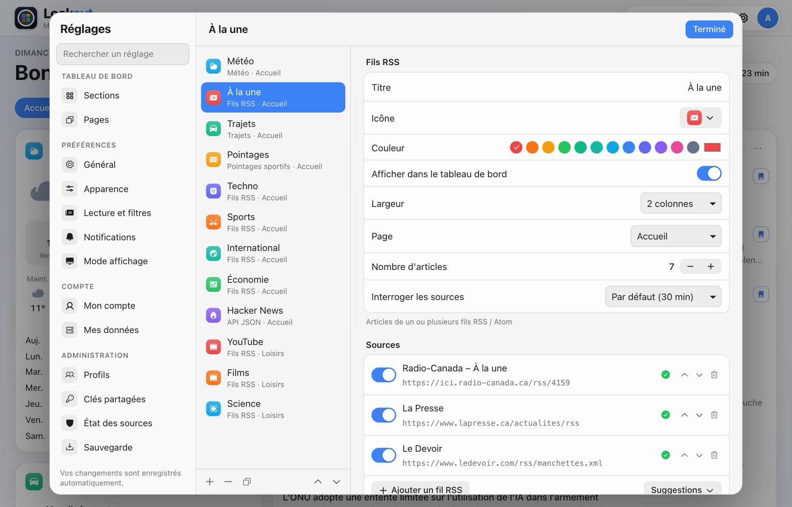

*Fils par catégorie…* crée d'un coup une section prête à l'emploi pour un sujet (Films, Séries et télé,
Culture, Science, Jeux vidéo, etc.), avec trois sources dans la langue de l'interface.

### YouTube

Les dernières vidéos de vos chaînes, en vignettes. Aucune clé n'est nécessaire.

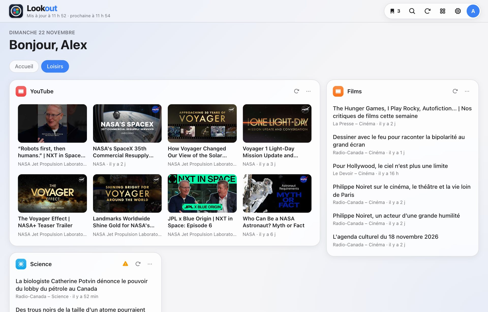

- **Ajouter une chaîne** : collez son adresse (`youtube.com/@nom`) ou son `@nom`.
- **Importer mes abonnements…** : reprend toutes vos chaînes d'un coup à partir d'un fichier de Google Takeout.
  Le bouton `i` donne la marche à suivre.
- **Compte Google** : si l'administrateur l'a configuré, *Relier mon compte Google* tient la liste à jour
  d'après vos abonnements, une fois par jour. Lookout ne demande que la lecture de vos abonnements. Dans ce
  mode, les chaînes ajoutées à la main qui ne font pas partie de vos abonnements sont retirées à chaque
  synchronisation.
- **Lire les vidéos dans Lookout** : un clic ouvre la vidéo par-dessus le tableau de bord. `Cmd`-clic ou
  `Ctrl`-clic l'ouvre sur youtube.com.
- **Masquer les Shorts et les directs**.

### Météo

Conditions actuelles, prévisions horaires et quotidiennes pour un lieu, par Open-Meteo. Au Canada, les alertes
d'Environnement Canada s'affichent en tête de carte. Options : alertes, détails (ressenti, vent, humidité,
soleil), nombre d'heures et de jours.

### Trajets

Temps de parcours pour un ou plusieurs trajets (départ, destination, mode de déplacement).

| Service | Circulation en direct | Clé |
|---|---|---|
| OSRM | Non | Aucune |
| TomTom | Oui | Clé gratuite |
| Home Assistant | Selon votre capteur (Waze, Google Maps) | Adresse et jeton de votre Home Assistant |

### Pointages sportifs

Résultats, matchs en cours et à venir, classement.

- **Ligues** : ESPN (LNH, NFL, NBA, MLB, MLS, LCF, etc., ou toute autre ligue par son chemin), HockeyTech
  (LHJMQ, LPHF, OHL, WHL, LAH), API-Sports (avec clé).
- **Équipes** : pour chaque ligue, *Toutes les équipes* ou seulement celles que vous suivez.
- Pendant un match d'une équipe suivie, la section se met à jour chaque minute.

### API JSON

Une liste tirée de n'importe quelle API qui renvoie du JSON. Vous indiquez l'adresse, les en-têtes éventuels
et le chemin des champs (liste, titre, sous-titre, lien, date, image). Voir [Sources et clés](sources.md#api-json).

### Agenda

Les prochains événements d'un ou plusieurs calendriers, regroupés par jour.

- **Calendriers** : collez l'adresse iCal de chacun (Google Agenda, iCloud, Outlook, ou tout fichier `.ics`).
  Le bouton `i` indique où la trouver. Aucune clé ni connexion : Lookout lit le calendrier, sans le modifier.
- L'adresse donne accès à tout le calendrier : elle est gardée sur le serveur et n'est plus affichée une fois
  enregistrée.
- **Affichage** : période (d'aujourd'hui à 30 jours), lieu, événements d'aujourd'hui déjà terminés.
- Les événements répétés, les exceptions et les journées entières sont pris en compte.

### Home Assistant

L'état des entités de votre choix : températures, portes, lumières, aspirateur, consommation…

- **Connexion** : l'adresse de Home Assistant et un **jeton d'accès longue durée** (dans Home Assistant : votre
  profil → *Sécurité* → *Jetons d'accès de longue durée*). Le jeton reste sur le serveur de Lookout et n'est
  plus affiché une fois enregistré.
- **Entités** : *Choisir des entités…* cherche parmi celles de Home Assistant ; Lookout ne lit que celles que
  vous cochez, dans l'ordre que vous leur donnez. Chacune peut recevoir un nom d'affichage.
- **Commandes** : la carte offre un interrupteur pour les lumières, les prises, les ventilateurs et les
  interrupteurs virtuels, et un bouton pour les stores, les scènes, les scripts et les automatisations.
  L'option se désactive ; les serrures et les alarmes ne peuvent jamais être actionnées depuis Lookout.
- Le serveur de Lookout doit pouvoir joindre Home Assistant (même réseau, ou adresse publique).

### Classements et statistiques

Le classement complet de vos ligues et leurs meneurs, dans une carte à onglets.

- **Ligues** : les mêmes que pour les pointages, côté ESPN (LNH, NFL, NBA, MLB, MLS, soccer européen) et
  HockeyTech (LHJMQ, LPHF, OHL, WHL, LAH). Avec plusieurs ligues, la carte offre un onglet par ligue.
- **Mes équipes** : choisissez-les pour chaque ligue ; elles sont mises en évidence dans le classement et chez
  les meneurs.
- **Classement** : par association ou par division (ligues ESPN qui en ont), avec la fiche, les points, le
  différentiel, les dix derniers matchs et la séquence. *Seulement les groupes de mes équipes* raccourcit la
  carte. Sur une carte étroite, les colonnes secondaires sont masquées.
- **Meneurs** : les meilleurs joueurs par catégorie (points, buts, passes et gardiens au hockey ; verges et
  touchés au football ; points, rebonds et passes au basketball ; moyenne, circuits et lanceurs au baseball).
  Le nombre par catégorie se règle de 1 à 10. Non offert pour le soccer.
- Les ligues API-Sports ne sont pas offertes ici.

### Bourse et devises

Le cours de titres, d'indices et de paires de devises, avec la variation du jour.

- *Rechercher un titre…* trouve un symbole par le nom de l'entreprise ; *Suggestions* propose les grands
  indices et les devises courantes.
- Les symboles sont ceux de Yahoo Finance : `SHOP.TO` (Bourse de Toronto), `USDCAD=X` (devises), `^GSPTSE`
  (indice).
- Les cours sont souvent différés d'une quinzaine de minutes et donnés à titre indicatif.

### Sorties

Les premières de saisons de séries (TVmaze, sans clé) et les films en salle ou à venir (TMDB, clé gratuite),
pour un pays et une période.

### Résumé du jour

L'essentiel de vos fils en quelques points, rédigé par Claude. Il faut une clé Anthropic, la vôtre ou celle
que l'administrateur vous a ouverte.

- **Modèle** : Claude Opus 5.5 (par défaut), Sonnet 5.5 ou Haiku 5.5, du plus capable au plus économique.
- **Accent particulier** : une consigne libre, par exemple « le Québec et la techno d'abord ».
- **Sections résumées** : tous vos fils, ou seulement ceux que vous cochez.
- Seuls les titres des dernières 24 heures sont envoyés à Anthropic. Un nouveau résumé n'est demandé que si
  les titres ont changé, et jamais plus d'une fois par heure.

## Lire les articles

- Un clic ouvre l'article dans un nouvel onglet et le marque comme lu.
- **Lire ici** : le bouton en forme de livre, sur chaque article, ouvre son texte dans un lecteur intégré, sans
  quitter Lookout. Pour en faire le comportement du clic : *Réglages → Lecture et filtres → Ouvrir les articles
  dans Lookout*. Cmd-clic ou Ctrl-clic ouvre toujours un nouvel onglet.
- Certains sites refusent le lecteur ou réservent leurs articles aux abonnés : un bouton ouvre alors l'article
  sur le site.
- Les articles lus sont atténués (réglable). L'état « lu » est enregistré sur le serveur : il vous suit sur
  tous vos appareils.
- La pastille **Nouveau** signale les articles parus depuis votre visite précédente sur cet appareil. Le repère
  n'avance que si vous êtes parti au moins dix minutes.
- **Nouveaux et non lus d'abord** : chaque carte montre d'abord les articles parus depuis votre dernière
  visite, puis les autres non lus ; un article déjà lu ne revient que s'il reste de la place. Un article que
  vous venez d'ouvrir garde sa place jusqu'à la prochaine mise à jour. Se désactive dans
  *Réglages → Lecture et filtres*.
- **Tout marquer comme lu** : le bouton ✓ dans l'en-tête d'une carte marque tous ses articles affichés ; un
  bandeau permet d'annuler. Il n'apparaît que s'il reste des articles non lus.
- **Doublons** : quand plusieurs sections d'une même page reçoivent la même nouvelle (à la une, international,
  politique…), seule la première dans l'ordre de la page l'affiche ; les autres montrent l'article suivant.
  Sous l'article, la mention *aussi dans…* nomme les sections qui l'ont reçu elles aussi. Se désactive dans
  *Réglages → Lecture et filtres*.
- **Mots-clés suivis** (*Réglages → Lecture et filtres*) : un article qui en contient un est mis en évidence
  dans toutes vos sections, et peut déclencher une notification.
- Clic droit sur un article (ordinateur) : ouvrir, copier le lien, garder pour plus tard, marquer lu ou non lu.

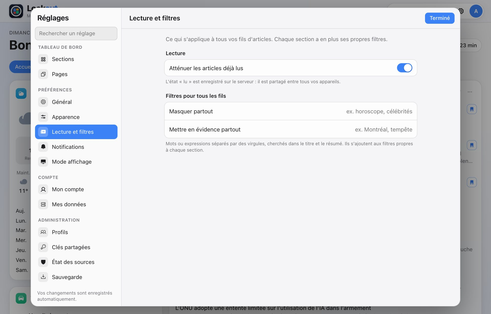

## Recherche

La loupe, ou la touche `/`, cherche dans les articles de **toutes** vos sections, toutes pages confondues, dans
les événements de vos agendas et dans *À lire plus tard*. Plusieurs mots doivent tous être présents.

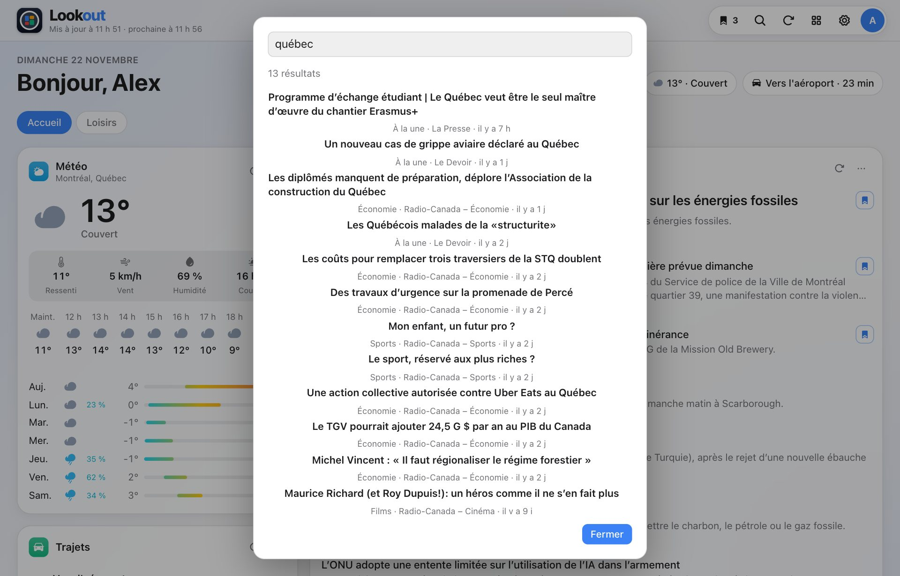

## À lire plus tard

Le signet sur un article le garde dans une liste personnelle. Il apparaît au survol à la souris et reste
toujours visible au doigt. La liste (200 articles au plus) est enregistrée sur le serveur et commune à vos
appareils. Elle s'ouvre par le bouton à signet de la barre du haut.

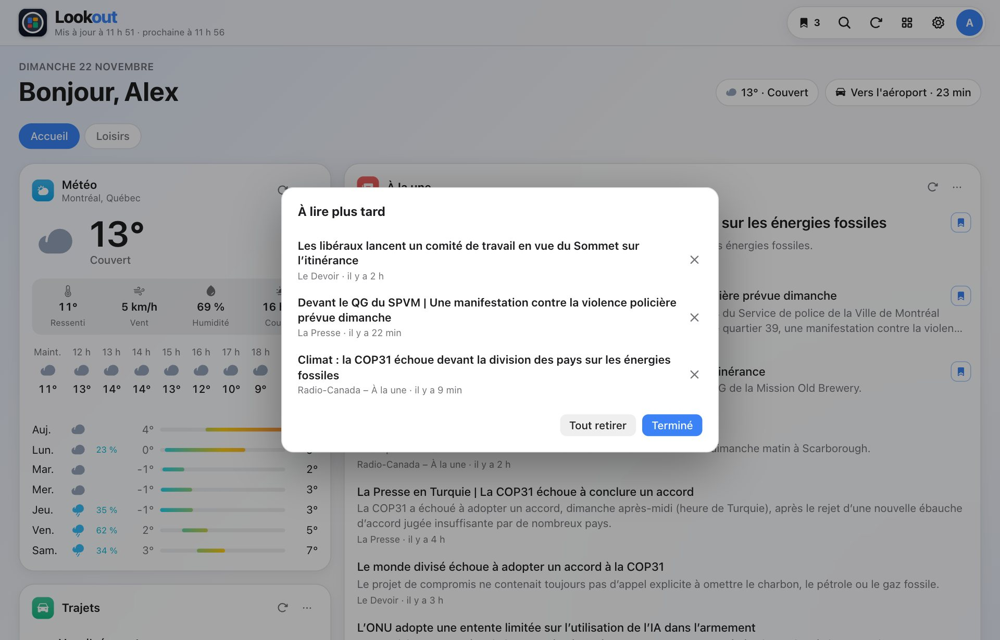

## Notifications

*Réglages → Notifications.* Lookout peut vous prévenir même quand la page est fermée.

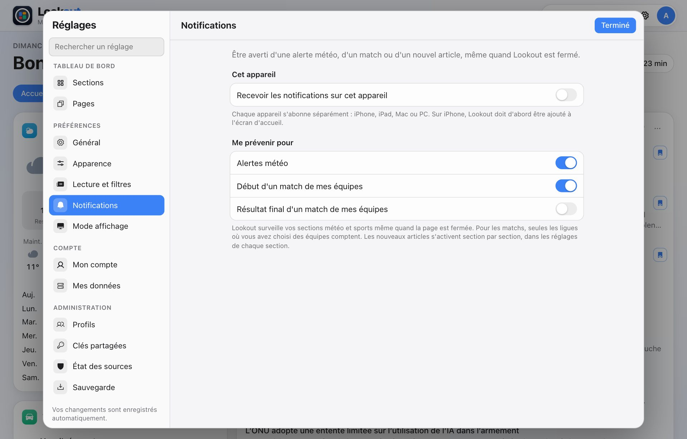

**Conditions**
- L'adresse doit être en **HTTPS**.
- Sur **iPhone ou iPad**, ajoutez d'abord Lookout à l'écran d'accueil (*Partager → Sur l'écran d'accueil*) et
  ouvrez-le depuis son icône.
- Sur **Mac ou PC**, utilisez Safari, Chrome, Edge ou Firefox, et autorisez les notifications de ce navigateur
  dans les réglages du système.

**Ce qui déclenche une notification**
- une nouvelle **alerte météo** pour une de vos sections météo ;
- le **début d'un match** d'une équipe suivie, et son **résultat final** si vous l'activez ;
- un **nouvel article** dans une section où vous avez activé *Notifier les nouveaux articles*. Un toucher sur
  la notification ouvre l'article. Au-delà de trois nouveautés d'un coup, une seule notification les annonce ;
- un article qui contient un de vos **mots-clés suivis**, dans n'importe lequel de vos fils (sauf YouTube).

**Heures calmes.** Pendant la plage choisie (22 h à 7 h par défaut), rien n'est envoyé, et rien n'est rattrapé
ensuite. Les alertes météo peuvent passer quand même.

**Résumé du matin.** À l'heure choisie, une notification réunit la météo, vos rendez-vous du jour et les grands
titres de vos premières sections.

Les heures calmes et le résumé du matin suivent l'heure du serveur.

Chaque appareil s'abonne séparément. Le bouton *Envoyer une notification d'essai* vérifie le chemin complet
pour cet appareil. Le délai d'une notification d'article dépend de l'intervalle de la section.

## Mode affichage

Pour un écran mural, une tablette ou une télé : plein écran, sans boutons, avec l'heure. Les pages défilent
(durée réglable dans *Réglages → Mode affichage*) et l'écran reste allumé.

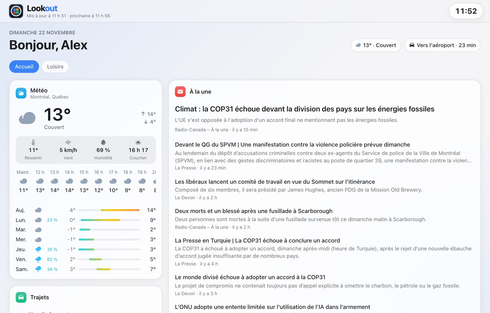

- **Entrer** : pastille du compte → *Mode affichage*, ou les réglages.
- **Sortir** : touche `Échap`, ou touchez l'écran puis *Quitter*.
- L'adresse garde `?affichage=1` : enregistrez-la en signet pour y revenir directement.

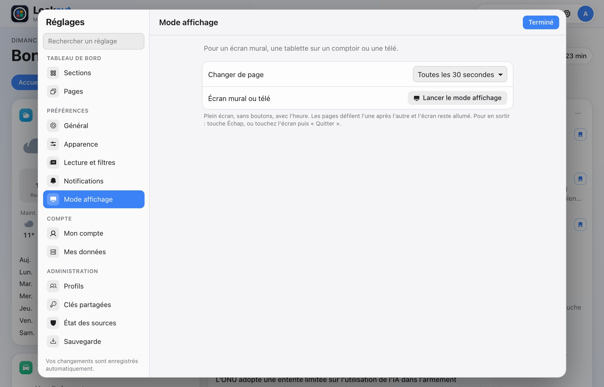

## Les réglages

L'engrenage, ou `Cmd`+`,`. Les changements sont enregistrés automatiquement. Un champ de recherche en haut de
la navigation retrouve un réglage par mot-clé.

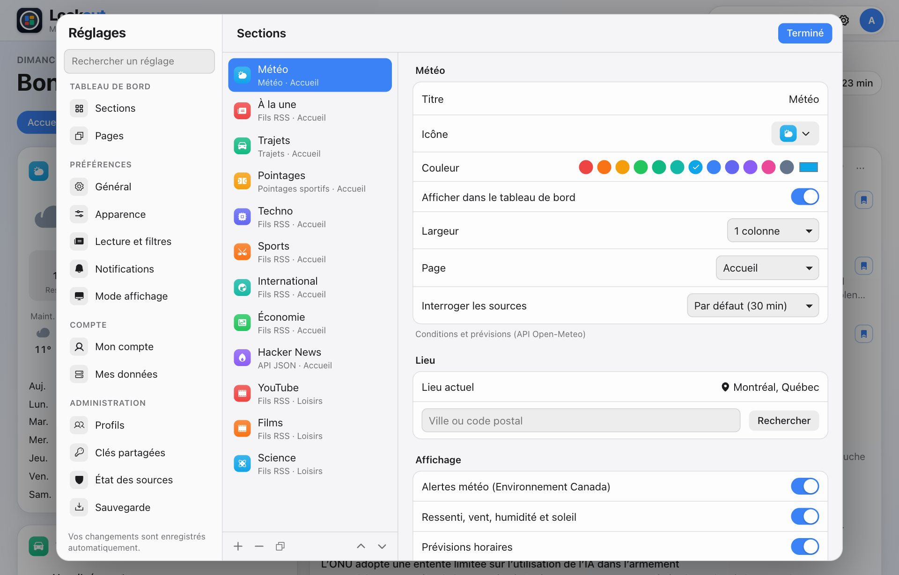

| Groupe | Rubrique | Ce qu'on y trouve |
|---|---|---|
| Tableau de bord | Sections et pages | L'arborescence des pages et de leurs sections : ajouter, glisser d'une page à l'autre, renommer ou supprimer une page (menu `⋯`), configurer, dupliquer ou supprimer chaque section |
| | Apparence | Thème, couleur d'accent, arrière-plan, densité, nombre de colonnes |
| | Mode affichage | Durée de chaque page ; lancer le mode |
| Préférences | Général | Langue, unités, message d'accueil, intervalle de mise à jour par défaut |
| | Lecture et filtres | Atténuer les articles lus ; doublons ; lecteur intégré ; mots masqués et mots-clés suivis dans tous les fils |
| | Notifications | Abonner cet appareil ; choisir ce qui déclenche une notification ; heures calmes ; résumé du matin |
| Compte | Mon compte | Mot de passe, déconnexion |
| | Mes données | Exporter, importer ou réinitialiser sa propre configuration |
| — | À propos | Version, emplacement des réglages, liens |

Les administrateurs voient en plus le groupe *Administration* : voir le [guide d'administration](administration.md).

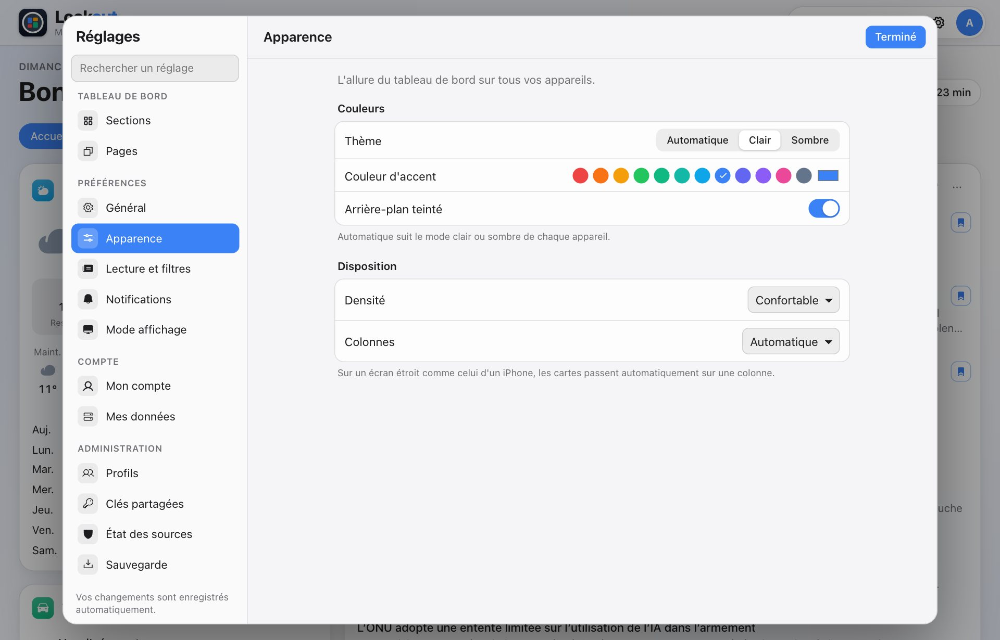

**Mise à jour des sources.** Chaque source est interrogée au plus une fois par intervalle, même si vous
rechargez la page plus souvent : cela évite qu'un site vous bloque. L'intervalle par défaut est de 30 minutes ;
les pointages, les trajets et Home Assistant ont 5 minutes, l'agenda et la Bourse 15 minutes, YouTube et les classements une heure,
les sorties et le résumé 2 heures. Chaque section peut avoir le sien. Une source en panne est réessayée deux
fois à deux minutes d'intervalle, puis au rythme normal. Quand des données sont à renouveler, la carte affiche
d'abord celles qu'elle a, puis se met à jour quelques secondes plus tard.

**Export et import.** Le fichier exporté contient vos sections, vos sources et vos préférences, mais ni vos
clés ni vos jetons.

## Raccourcis clavier

| Touche | Action |
|---|---|
| `/` ou `Cmd`/`Ctrl`+`K` | Rechercher dans les articles et les agendas |
| `R` | Actualiser toutes les sections |
| `E` | Organiser le tableau de bord |
| `L` | Ouvrir *À lire plus tard* |
| `1` à `9` | Aller à la page de ce rang |
| `←` `→` | Page précédente ou suivante |
| `?` | Afficher la liste des raccourcis |
| `Cmd`/`Ctrl`+`,` | Ouvrir les réglages |
| `Échap` | Fermer une fenêtre, annuler un glissement, quitter le mode affichage |

## Sur iPhone et iPad

Dans Safari : *Partager → Sur l'écran d'accueil*. Lookout s'ouvre alors comme une app, en plein écran, et peut
recevoir des notifications. Les cartes passent sur une colonne et les réglages s'affichent une rubrique à la
fois, avec un bouton *Retour*.

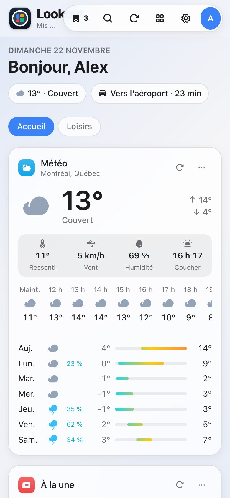 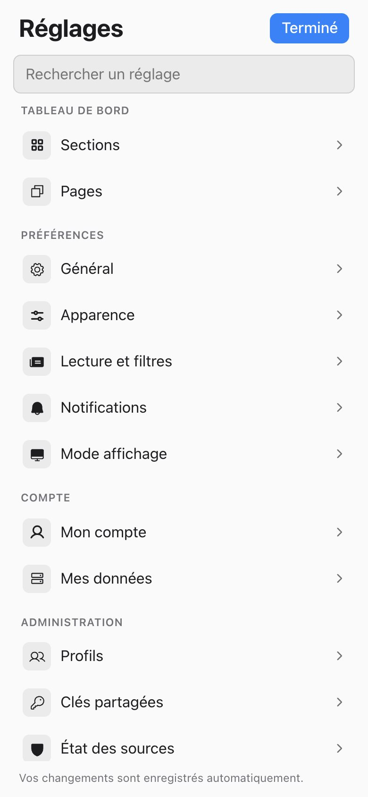 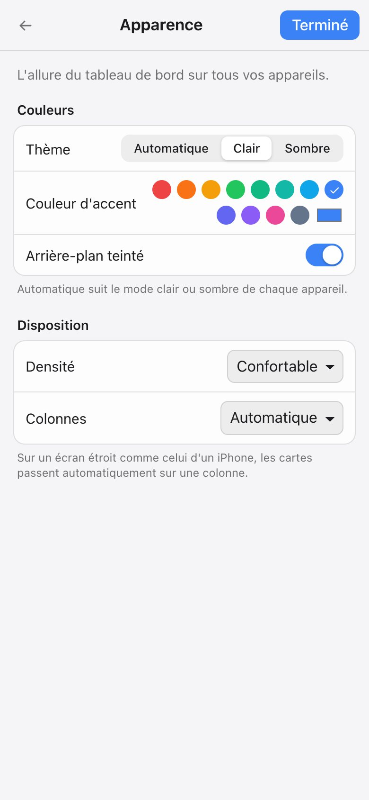

